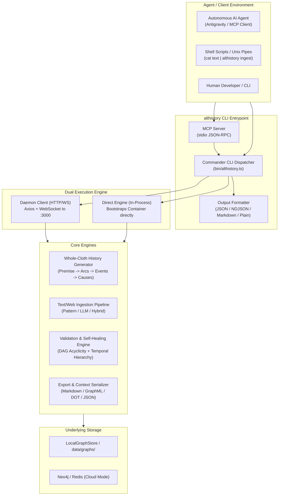
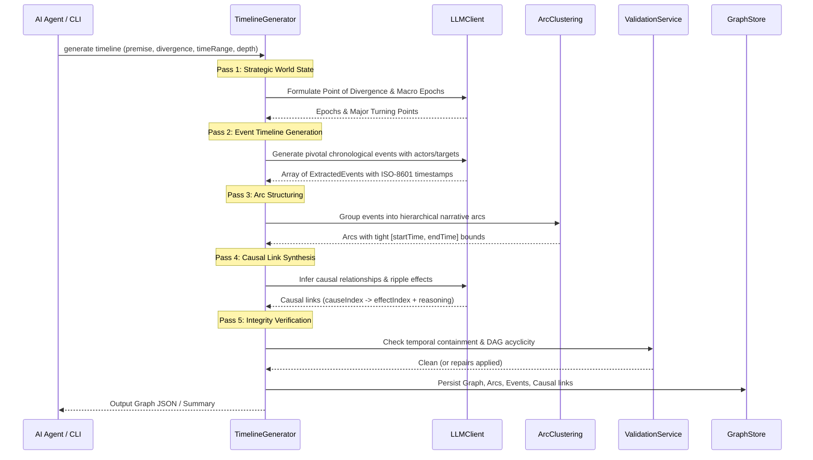

# Design Document: CLI Agent Interface

## 1. Overview & Architectural Goals

The **Althistory CLI (`althistory`)** is an automated, high-performance command-line interface engineered for autonomous AI agents, script pipelines, and human developers. It enables building rich temporal-causal graphs from unstructured text or generating entire counterfactual timelines whole cloth from creative premises.



---

## 2. Package Architecture & Layout

The CLI is structured as a first-class package `cli/` within the Althistory monorepo:

```
althistory/
├── cli/
│   ├── bin/
│   │   └── althistory.ts            # Executable CLI shebang entrypoint
│   ├── src/
│   │   ├── commands/
│   │   │   ├── ingest.ts            # Text, URL, and Wikidata ingestion commands
│   │   │   ├── generate.ts          # Whole-cloth timeline and branch generation
│   │   │   ├── graph.ts             # Graph CRUD, branching, merging, rollback
│   │   │   ├── event.ts             # Event add, list, update, delete
│   │   │   ├── arc.ts               # Arc create, list, nest, assign
│   │   │   ├── causal.ts            # Causal link, unlink, paths, cycles
│   │   │   ├── validate.ts          # Graph integrity and consistency diagnostics
│   │   │   ├── export.ts            # Export to JSON, Markdown, DOT, GraphML
│   │   │   ├── import.ts            # File import with conflict strategies
│   │   │   └── mcp.ts               # Model Context Protocol stdio server
│   │   ├── engine/
│   │   │   ├── ExecutionContext.ts  # Resolves Daemon vs Direct execution mode
│   │   │   ├── DirectEngine.ts      # Boots timeline Container in-process
│   │   │   ├── RemoteEngine.ts      # Axios/WebSocket API client
│   │   │   └── IEngine.ts           # Unified interface for all CLI operations
│   │   ├── generator/
│   │   │   ├── TimelineGenerator.ts # Multi-pass whole-cloth synthesis
│   │   │   ├── prompts.ts           # Prompt templates for counterfactual timelines
│   │   │   └── arcClustering.ts     # Temporal/actor clustering into Arcs
│   │   ├── mcp/
│   │   │   ├── McpServer.ts         # Model Context Protocol server over stdio
│   │   │   └── toolDefinitions.ts   # JSON Schema tool contracts for AI agents
│   │   ├── formatters/
│   │   │   ├── jsonFormatter.ts     # Pure machine-readable JSON
│   │   │   ├── ndjsonFormatter.ts   # Streaming line-delimited JSON
│   │   │   ├── markdownFormatter.ts # Chronological Markdown timeline tables
│   │   │   └── tableFormatter.ts    # Human-readable terminal output
│   │   └── utils/
│   │       ├── exitCodes.ts         # Semantic Unix exit code constants
│   │       └── logger.ts            # Stderr logger (progress bars, spinners)
│   ├── package.json
│   ├── tsconfig.json
│   └── vitest.config.ts
```

---

## 3. Dual-Mode Execution Architecture

To enable agents to work in both headless CI/script environments and live interactive development environments, the CLI abstracts execution via `IEngine`:

```typescript
export interface IEngine {
  // Graph operations
  listGraphs(): Promise<GraphMetadata[]>;
  createGraph(name: string, description?: string): Promise<Graph>;
  getGraph(id: string): Promise<GraphDetails>;
  branchGraph(id: string, name: string): Promise<Graph>;
  mergeGraph(sourceId: string, targetId: string, strategy: MergeStrategy): Promise<MergeResult>;
  rollbackGraph(id: string, version: string): Promise<RollbackResult>;
  deleteGraph(id: string): Promise<void>;

  // Entity operations
  createEvent(graphId: string, data: CreateEventInput): Promise<Event>;
  listEvents(graphId: string, filters?: EventFilters): Promise<Event[]>;
  createArc(graphId: string, data: CreateArcInput): Promise<Arc>;
  createCausalLink(graphId: string, data: CreateCausalInput): Promise<CausalRelationship>;

  // Ingestion & Generation
  ingestText(graphId: string, text: string, options: IngestionOptions): Promise<IngestResult>;
  generateTimeline(options: TimelineGenerationOptions): Promise<GenerationResult>;
  generateBranch(options: BranchGenerationOptions): Promise<GenerationResult>;

  // Verification & Export
  validateGraph(graphId: string, strict: boolean): Promise<ValidationReport>;
  exportGraph(graphId: string, format: ExportFormat): Promise<string>;
  importGraph(fileContent: string, options: ImportOptions): Promise<ImportResult>;
}
```

### Auto-Detection Logic in `ExecutionContext`:
1. If `--direct` is passed: use `DirectEngine`.
2. Otherwise, perform a lightweight `GET /api/health` against `http://localhost:3000` (or `--url`):
   - If response `200 OK`: use `RemoteEngine`.
   - If connection refused / ECONNREFUSED: print advisory to `stderr` (`"Daemon not detected on localhost:3000. Running in direct local mode."`) and fall back to `DirectEngine`.

---

## 4. Whole-Cloth History Generation Engine

Generating plausible alternate histories whole-cloth requires a multi-pass pipeline that avoids hallucinated timestamps or causality violations:



### Prompt Engineering for Generation:
* **Pass 1 (Anchor & Macro Structure)**:
  ```text
  You are an expert counterfactual historian.
  Premise: {premise}
  Point of Divergence: {divergencePoint}
  Time Range: {startDate} to {endDate}
  Output 3-5 macro historical Epochs/Arcs that structure this divergent era.
  ```
* **Pass 2 (Chronological Micro-Events)**:
  ```text
  Generate {eventCount} specific, plausible historical events resulting from the divergence point.
  For each event provide: description, timestamp (ISO-8601), primary actor, primary target, and historical significance.
  Strict constraint: All timestamps must strictly advance chronologically and be plausible consequences of the divergence.
  ```
* **Pass 3 (Causal Ripple Chains)**:
  ```text
  Analyze the following generated events. Link causes to effects.
  Strict constraints:
  1. A cause MUST NOT follow its effect in time (cause.timestamp <= effect.timestamp). A cause at the same moment as its effect is allowed; the two can be part of the same occurrence.
  2. No circular dependencies (DAG).
  3. Specify the causal strength (0.0 to 1.0) and historical mechanism.
  ```

---

## 5. Text-to-History Ingestion Pipeline

The CLI integrates the existing `IngestionOrchestrator`, `TextExtractor`, `WikipediaExtractor`, and `WikidataExtractor`:

```
Input Stream (File / Pipe / URL)
       │
       ▼
┌──────────────────────────┐
│ Extractor Selection      │
│  • Pattern (Regex dates) │
│  • LLM (Anthropic/OpenAI)│
│  • Hybrid                │
└──────────────┬───────────┘
               │
               ▼
┌──────────────────────────┐
│ Entity Deduplication &   │
│ Confidence Thresholding  │
└──────────────┬───────────┘
               │
               ▼
┌──────────────────────────┐
│ Automatic Arc Clustering │
│ (Assigns events to arcs) │
└──────────────┬───────────┘
               │
               ▼
┌──────────────────────────┐
│ Causal Inference Engine  │
│ (Infers causal links)    │
└──────────────┬───────────┘
               │
               ▼
┌──────────────────────────┐
│ Atomic Commit & Version  │
│ Recording to Graph       │
└──────────────────────────┘
```

---

## 6. Model Context Protocol (MCP) Integration

The CLI implements an MCP (Model Context Protocol) stdio server (`althistory mcp`), enabling tools to be directly declared to AI coding assistants without shell invocation overhead:

### Exposed MCP Tools:
1. `althistory_ingest_text`: Extract events, arcs, and causal links from provided text.
2. `althistory_generate_timeline`: Synthesize a whole-cloth alternate history timeline from a counterfactual premise.
3. `althistory_branch_timeline`: Fork an existing history at a divergence event with a new scenario.
4. `althistory_query_causal_path`: Trace causal chains and ripple paths between two events.
5. `althistory_validate_graph`: Audit a timeline for temporal, hierarchy, and causal paradoxes.
6. `althistory_export_context`: Export a timeline into markdown format optimized for LLM context windows.

---

## 7. Command Reference & CLI Syntax

```bash
# Ingest raw text or pipe
cat source.txt | althistory ingest text --graph-id g-123 --group-arcs --infer-causes --json

# Ingest from Wikipedia
althistory ingest url "https://en.wikipedia.org/wiki/Punic_Wars" --graph-name "Punic Wars" --depth 2

# Generate whole-cloth alternate history
althistory generate timeline \
  --premise "What if Rome never conquered Greece?" \
  --divergence-point "146 BC: The Achaean League defeats Lucius Mummius at Corinth" \
  --start-date "-0146-01-01" \
  --end-date "0200-01-01" \
  --event-count 20 \
  --depth 2 \
  --json

# Branch an existing timeline at a divergence point
althistory generate branch \
  --source-graph "g-rome-canon" \
  --diverge-at-event "evt-caesar-crossing-rubicon" \
  --counterfactual "Caesar disbands his legions and returns to Rome as a private citizen" \
  --branch-name "Rome Without Caesar" \
  --json

# Query causal pathways
althistory causal paths --graph g-123 --from evt-1 --to evt-15 --json

# Validate graph integrity
althistory validate g-123 --strict --json

# Export formatted markdown table for LLM prompt context
althistory export g-123 --format markdown
```

---

## 8. Exit Codes & Agent Ergonomics

| Exit Code | Identifier | Description |
| :---: | :--- | :--- |
| `0` | `SUCCESS` | Command completed successfully. |
| `1` | `GENERAL_ERROR` | Unhandled error, invalid flag, or exception. |
| `2` | `VALIDATION_FAILED` | Temporal violation, causal loop, or hierarchy constraint error. |
| `3` | `AUTH_FAILED` | Missing or invalid API key, or insufficient permissions. |
| `4` | `NOT_FOUND` | Specified graph, event, arc, or version does not exist. |
| `5` | `CONNECTION_ERROR` | Daemon unreachable when `--url` was explicitly enforced. |

### Output Protocol Guarantee:
* `stdout`: Contains **only** the requested format (JSON, NDJSON, Markdown, or clean tables). Never contains ANSI escape codes when non-TTY or `--json` is active.
* `stderr`: Contains **all** status messages, progress bars, debug traces, and warnings.
