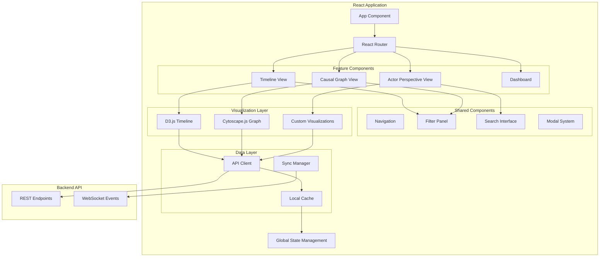

# Design Document

## Overview

The Frontend Timeline Interface is a React-based web application that provides interactive visualization and manipulation capabilities for hierarchical temporal graphs. Building on the existing backend API and leveraging D3.js and Cytoscape.js for visualizations, the frontend enables historians and researchers to explore, create, and analyze historical events, arcs, and causal relationships through intuitive interfaces.

The design emphasizes performance, usability, and real-time interaction while maintaining data integrity through backend validation. The interface supports multiple visualization modes, advanced filtering, and collaborative features for historical research workflows.

## Architecture

### Frontend Architecture



### Technology Stack

- **Frontend Framework**: React 19.1 with TypeScript
- **State Management**: Zustand for global state, React Query for server state
- **Visualization**: D3.js v7.9.0 for timeline, Cytoscape.js v3.33.0 for causal graphs
- **UI Components**: Custom components with Tailwind CSS
- **Routing**: React Router v7
- **HTTP Client**: Axios v1.11.0 with interceptors for error handling
- **Real-time**: WebSocket connection for live updates
- **Testing**: Vitest, React Testing Library, Playwright for E2E

## Components and Interfaces

### Core Application Structure

#### App Component
```typescript
interface AppProps {
  initialRoute?: string;
}

interface AppState {
  user: User | null;
  theme: 'light' | 'dark';
  notifications: Notification[];
}

const App: React.FC<AppProps> = ({ initialRoute }) => {
  // Main application shell with routing and global providers
};
```

#### Global State Management
```typescript
interface GlobalState {
  // Data state
  events: Event[];
  arcs: Arc[];
  causalRelationships: CausalRelationship[];
  inferredPressures: InferredPressure[];
  
  // UI state
  selectedEvents: string[];
  selectedArcs: string[];
  activeFilters: FilterState;
  viewMode: 'timeline' | 'causal' | 'actor-perspective';
  
  // Loading states
  isLoading: boolean;
  loadingOperations: Set<string>;
  
  // Error handling
  errors: ErrorState[];
  
  // Actions
  actions: {
    setEvents: (events: Event[]) => void;
    setArcs: (arcs: Arc[]) => void;
    addEvent: (event: Event) => void;
    updateEvent: (id: string, updates: Partial<Event>) => void;
    deleteEvent: (id: string) => void;
    setFilters: (filters: FilterState) => void;
    setViewMode: (mode: ViewMode) => void;
    clearErrors: () => void;
  };
}
```

### Visualization Components

#### Timeline View Component
```typescript
interface TimelineViewProps {
  className?: string;
  onEventSelect?: (event: Event) => void;
  onArcSelect?: (arc: Arc) => void;
  onTimeRangeChange?: (range: TimeRange) => void;
}

interface TimelineViewState {
  zoomLevel: number;
  visibleTimeRange: TimeRange;
  selectedElements: Set<string>;
  dragState: DragState | null;
}

const TimelineView: React.FC<TimelineViewProps> = ({
  className,
  onEventSelect,
  onArcSelect,
  onTimeRangeChange
}) => {
  // Timeline visualization with D3.js integration
  // Handles event creation, arc management, and temporal navigation
};
```

#### Causal Graph View Component
```typescript
interface CausalGraphViewProps {
  className?: string;
  focusEventId?: string;
  maxDepth?: number;
  onPathSelect?: (path: CausalPath) => void;
}

interface CausalGraphViewState {
  layout: 'force-directed' | 'hierarchical' | 'circular';
  filterWeightThreshold: number;
  highlightedPath: CausalPath | null;
  nodePositions: Map<string, { x: number; y: number }>;
}

const CausalGraphView: React.FC<CausalGraphViewProps> = ({
  className,
  focusEventId,
  maxDepth = 3,
  onPathSelect
}) => {
  // Cytoscape.js integration for causal relationship visualization
  // Supports multiple layout algorithms and interactive exploration
};
```

#### Actor Perspective View Component
```typescript
interface ActorPerspectiveViewProps {
  actorId: string;
  className?: string;
  onEventSelect?: (event: Event) => void;
}

interface ActorPerspectiveViewState {
  actorEvents: Event[];
  actorArcs: Arc[];
  roleFilter: 'all' | 'actor' | 'target';
  timelineLayout: 'chronological' | 'thematic';
}

const ActorPerspectiveView: React.FC<ActorPerspectiveViewProps> = ({
  actorId,
  className,
  onEventSelect
}) => {
  // Specialized timeline view focused on a single actor's involvement
  // Shows events where actor is either the actor or target
};
```

### Data Management Components

#### API Client
```typescript
interface APIClient {
  // Event operations
  events: {
    getAll: (filters?: EventFilters) => Promise<Event[]>;
    getById: (id: string) => Promise<Event>;
    create: (data: CreateEventRequest) => Promise<Event>;
    update: (id: string, data: UpdateEventRequest) => Promise<Event>;
    delete: (id: string) => Promise<void>;
    search: (query: string, filters?: EventFilters) => Promise<Event[]>;
  };
  
  // Arc operations
  arcs: {
    getAll: (filters?: ArcFilters) => Promise<Arc[]>;
    getById: (id: string) => Promise<Arc>;
    create: (data: CreateArcRequest) => Promise<Arc>;
    update: (id: string, data: UpdateArcRequest) => Promise<Arc>;
    delete: (id: string) => Promise<void>;
    getHierarchy: () => Promise<ArcHierarchyNode[]>;
  };
  
  // Causal operations
  causal: {
    getRelationships: (eventId?: string) => Promise<CausalRelationship[]>;
    createLink: (causeId: string, effectId: string, relationship: CausalRelationshipData) => Promise<void>;
    findChain: (startEventId: string, maxDepth: number) => Promise<CausalPath[]>;
    getSuggestions: (eventId: string) => Promise<CausalSuggestion[]>;
  };
  
  // Inference operations
  inference: {
    getPressures: (arcId?: string) => Promise<InferredPressure[]>;
    analyzeClusters: (events: Event[]) => Promise<EventCluster[]>;
    getPatterns: (timeRange: TimeRange) => Promise<Pattern[]>;
  };
  
  // Graph operations
  graph: {
    copyFull: (targetName: string) => Promise<CopyResult>;
    copyByTimeRange: (timeRange: TimeRange, targetName: string) => Promise<CopyResult>;
    copyByFilter: (filter: EntityFilter, targetName: string) => Promise<CopyResult>;
  };
}
```

#### Cache Management
```typescript
interface CacheManager {
  // Cache operations
  get: <T>(key: string) => T | null;
  set: <T>(key: string, value: T, ttl?: number) => void;
  invalidate: (pattern: string) => void;
  clear: () => void;
  
  // Specialized cache methods
  cacheEvents: (events: Event[], filters?: EventFilters) => void;
  getCachedEvents: (filters?: EventFilters) => Event[] | null;
  cacheArcs: (arcs: Arc[]) => void;
  getCachedArcs: () => Arc[] | null;
  
  // Cache statistics
  getStats: () => CacheStats;
}
```

### UI Components

#### Filter Panel Component
```typescript
interface FilterPanelProps {
  filters: FilterState;
  onFiltersChange: (filters: FilterState) => void;
  availableActors: string[];
  availableTargets: string[];
  timeRange: TimeRange;
}

interface FilterState {
  dateRange: TimeRange | null;
  actors: string[];
  targets: string[];
  eventTypes: string[];
  arcLevels: number[];
  causalWeightRange: [number, number];
  confidenceThreshold: number;
  searchQuery: string;
}

const FilterPanel: React.FC<FilterPanelProps> = ({
  filters,
  onFiltersChange,
  availableActors,
  availableTargets,
  timeRange
}) => {
  // Collapsible panel with all filtering options
  // Includes date pickers, multi-select dropdowns, sliders, and search
};
```

#### Event Detail Modal
```typescript
interface EventDetailModalProps {
  event: Event | null;
  isOpen: boolean;
  onClose: () => void;
  onSave: (updates: UpdateEventRequest) => Promise<void>;
  onDelete: () => Promise<void>;
  relatedArcs: Arc[];
  causalRelationships: CausalRelationship[];
}

const EventDetailModal: React.FC<EventDetailModalProps> = ({
  event,
  isOpen,
  onClose,
  onSave,
  onDelete,
  relatedArcs,
  causalRelationships
}) => {
  // Modal for viewing and editing event details
  // Shows related arcs, causal relationships, and allows editing
};
```

#### Arc Detail Panel
```typescript
interface ArcDetailPanelProps {
  arc: Arc | null;
  isOpen: boolean;
  onClose: () => void;
  onSave: (updates: UpdateArcRequest) => Promise<void>;
  containedEvents: Event[];
  childArcs: Arc[];
  inferredPressures: InferredPressure[];
}

const ArcDetailPanel: React.FC<ArcDetailPanelProps> = ({
  arc,
  isOpen,
  onClose,
  onSave,
  containedEvents,
  childArcs,
  inferredPressures
}) => {
  // Side panel for arc details and management
  // Shows contained events, child arcs, and inferred pressures
};
```

## Data Models

### Frontend Data Types

#### Extended Event Interface
```typescript
interface EventWithRelations extends IEvent {
  // Computed properties
  relatedArcs: Arc[];
  causalRelationships: {
    causes: CausalRelationship[];
    effects: CausalRelationship[];
  };
  
  // UI state
  isSelected: boolean;
  isHighlighted: boolean;
  renderPosition?: { x: number; y: number };
}
```

#### Extended Arc Interface
```typescript
interface ArcWithRelations extends IArc {
  // Computed properties
  containedEvents: Event[];
  childArcs: Arc[];
  parentArc: Arc | null;
  inferredPressures: InferredPressure[];
  
  // Statistics
  eventCount: number;
  duration: number;
  
  // UI state
  isExpanded: boolean;
  isSelected: boolean;
  renderLevel: number;
}
```

#### Causal Relationship Data
```typescript
interface CausalRelationshipWithEvents {
  id: string;
  causeEvent: Event;
  effectEvent: Event;
  weight: number;
  evidence: string;
  confidence: number;
  relationship_type: 'direct' | 'indirect' | 'contributory';
  
  // UI state
  isHighlighted: boolean;
  isPartOfSelectedPath: boolean;
}
```

#### Inferred Pressure Data
```typescript
interface InferredPressureWithContext {
  id: string;
  description: string;
  confidence_score: number;
  pressure_type: 'economic' | 'social' | 'environmental' | 'political';
  evidence: Event[];
  
  // Relations
  affectedArcs: Arc[];
  influenceStrength: number;
  
  // UI state
  isVisible: boolean;
  renderColor: string;
}
```

### Visualization Data Structures

#### Timeline Render Data
```typescript
interface TimelineRenderData {
  events: EventRenderData[];
  arcs: ArcRenderData[];
  timeScale: d3.ScaleTime<number, number>;
  yScale: d3.ScaleLinear<number, number>;
  visibleTimeRange: TimeRange;
  zoomTransform: d3.ZoomTransform;
}

interface EventRenderData extends EventWithRelations {
  x: number;
  y: number;
  radius: number;
  color: string;
  isVisible: boolean;
}

interface ArcRenderData extends ArcWithRelations {
  x: number;
  y: number;
  width: number;
  height: number;
  color: string;
  isVisible: boolean;
  nestingLevel: number;
}
```

#### Causal Graph Render Data
```typescript
interface CausalGraphRenderData {
  nodes: CausalNodeData[];
  edges: CausalEdgeData[];
  layout: LayoutConfig;
  viewport: ViewportConfig;
}

interface CausalNodeData {
  id: string;
  event: Event;
  position: { x: number; y: number };
  size: number;
  color: string;
  label: string;
  isHighlighted: boolean;
  isSelected: boolean;
}

interface CausalEdgeData {
  id: string;
  source: string;
  target: string;
  relationship: CausalRelationship;
  weight: number;
  color: string;
  width: number;
  isHighlighted: boolean;
}
```

## User Interface Design

### Layout Structure

#### Main Application Layout
```typescript
interface MainLayoutProps {
  children: React.ReactNode;
}

const MainLayout: React.FC<MainLayoutProps> = ({ children }) => {
  return (
    <div className="app-container">
      <Header />
      <div className="main-content">
        <Sidebar />
        <div className="content-area">
          {children}
        </div>
        <FilterPanel />
      </div>
      <StatusBar />
    </div>
  );
};
```

#### Responsive Design Breakpoints
```typescript
const BREAKPOINTS = {
  mobile: '768px',
  tablet: '1024px',
  desktop: '1440px',
  wide: '1920px'
} as const;

interface ResponsiveConfig {
  mobile: {
    timeline: { height: 400, showLabels: false };
    causalGraph: { size: 'small', layout: 'compact' };
    filterPanel: { position: 'modal' };
  };
  tablet: {
    timeline: { height: 500, showLabels: true };
    causalGraph: { size: 'medium', layout: 'standard' };
    filterPanel: { position: 'sidebar' };
  };
  desktop: {
    timeline: { height: 600, showLabels: true };
    causalGraph: { size: 'large', layout: 'expanded' };
    filterPanel: { position: 'sidebar' };
  };
}
```

### Interaction Patterns

#### Timeline Interactions
```typescript
interface TimelineInteractions {
  // Navigation
  onZoom: (zoomLevel: number, center: Date) => void;
  onPan: (direction: 'left' | 'right', amount: number) => void;
  onTimeRangeSelect: (range: TimeRange) => void;
  
  // Event interactions
  onEventClick: (event: Event, position: { x: number; y: number }) => void;
  onEventDoubleClick: (event: Event) => void;
  onEventDrag: (event: Event, newTimestamp: Date) => void;
  onEventHover: (event: Event | null) => void;
  
  // Arc interactions
  onArcClick: (arc: Arc) => void;
  onArcExpand: (arc: Arc) => void;
  onArcResize: (arc: Arc, newBounds: { start: Date; end: Date }) => void;
  onArcCreate: (timeRange: TimeRange) => void;
  
  // Creation interactions
  onTimelineDoubleClick: (timestamp: Date, position: { x: number; y: number }) => void;
  onEventAssignToArc: (event: Event, arc: Arc) => void;
}
```

#### Causal Graph Interactions
```typescript
interface CausalGraphInteractions {
  // Node interactions
  onNodeClick: (event: Event) => void;
  onNodeDoubleClick: (event: Event) => void;
  onNodeHover: (event: Event | null) => void;
  onNodeDrag: (event: Event, position: { x: number; y: number }) => void;
  
  // Edge interactions
  onEdgeClick: (relationship: CausalRelationship) => void;
  onEdgeHover: (relationship: CausalRelationship | null) => void;
  onEdgeWeightChange: (relationship: CausalRelationship, newWeight: number) => void;
  
  // Path interactions
  onPathHighlight: (path: CausalPath) => void;
  onPathSelect: (path: CausalPath) => void;
  
  // Layout interactions
  onLayoutChange: (layout: LayoutType) => void;
  onFilterByWeight: (minWeight: number) => void;
  
  // Creation interactions
  onCreateCausalLink: (cause: Event, effect: Event) => void;
}
```

## Performance Optimization

### Virtualization Strategy
```typescript
interface VirtualizationConfig {
  timeline: {
    maxVisibleEvents: 1000;
    bufferSize: 200;
    chunkSize: 100;
    useWebWorker: boolean;
  };
  causalGraph: {
    maxVisibleNodes: 500;
    levelOfDetail: boolean;
    clusterThreshold: 50;
    useWebGL: boolean;
  };
}

class VirtualizationManager {
  private visibleItems: Set<string> = new Set();
  private itemCache: Map<string, any> = new Map();
  
  updateVisibleItems(viewport: Viewport, allItems: any[]): any[] {
    // Calculate which items should be visible based on viewport
    // Return only visible items for rendering
  }
  
  preloadItems(items: any[]): void {
    // Preload items that are likely to become visible soon
  }
}
```

### Caching Strategy
```typescript
interface CacheStrategy {
  // Query result caching
  queryCache: {
    ttl: number;
    maxSize: number;
    evictionPolicy: 'lru' | 'lfu';
  };
  
  // Visualization data caching
  renderCache: {
    timeline: Map<string, TimelineRenderData>;
    causalGraph: Map<string, CausalGraphRenderData>;
    invalidationTriggers: string[];
  };
  
  // API response caching
  apiCache: {
    events: Map<string, Event[]>;
    arcs: Map<string, Arc[]>;
    relationships: Map<string, CausalRelationship[]>;
  };
}
```

### Progressive Loading
```typescript
interface ProgressiveLoadingConfig {
  initialLoad: {
    maxEvents: 100;
    maxArcs: 50;
    timeRange: 'recent' | 'all';
  };
  
  onDemandLoad: {
    chunkSize: 50;
    preloadDistance: 2; // chunks
    loadTrigger: 'scroll' | 'zoom' | 'filter';
  };
  
  backgroundLoad: {
    enabled: boolean;
    priority: 'low';
    maxConcurrent: 2;
  };
}
```

## Error Handling

### Error Types and Recovery
```typescript
interface ErrorHandlingStrategy {
  // Network errors
  networkErrors: {
    retry: {
      maxAttempts: 3;
      backoffStrategy: 'exponential';
      baseDelay: 1000;
    };
    fallback: {
      useCachedData: boolean;
      showOfflineMode: boolean;
    };
  };
  
  // Validation errors
  validationErrors: {
    showInline: boolean;
    highlightFields: boolean;
    preventSubmission: boolean;
  };
  
  // Visualization errors
  visualizationErrors: {
    fallbackRenderer: 'canvas' | 'svg';
    showErrorBoundary: boolean;
    logToConsole: boolean;
  };
}

class ErrorBoundary extends React.Component<ErrorBoundaryProps, ErrorBoundaryState> {
  constructor(props: ErrorBoundaryProps) {
    super(props);
    this.state = { hasError: false, error: null };
  }
  
  static getDerivedStateFromError(error: Error): ErrorBoundaryState {
    return { hasError: true, error };
  }
  
  componentDidCatch(error: Error, errorInfo: React.ErrorInfo) {
    // Log error to monitoring service
    console.error('Visualization error:', error, errorInfo);
  }
  
  render() {
    if (this.state.hasError) {
      return <ErrorFallback error={this.state.error} onRetry={this.handleRetry} />;
    }
    
    return this.props.children;
  }
}
```

## Testing Strategy

### Component Testing
```typescript
interface ComponentTestStrategy {
  // Unit tests for components
  unitTests: {
    framework: 'vitest' | 'jest';
    coverage: {
      threshold: 80;
      includeVisualization: boolean;
    };
    mocking: {
      apiCalls: boolean;
      d3Rendering: boolean;
      cytoscapeRendering: boolean;
    };
  };
  
  // Integration tests
  integrationTests: {
    framework: 'react-testing-library';
    scenarios: [
      'event-creation-flow',
      'arc-management-flow',
      'causal-link-creation',
      'filter-application',
      'view-switching'
    ];
  };
  
  // Visual regression tests
  visualTests: {
    framework: 'playwright';
    screenshots: boolean;
    crossBrowser: boolean;
    responsiveBreakpoints: boolean;
  };
}
```

### Performance Testing
```typescript
interface PerformanceTestStrategy {
  // Load testing
  loadTests: {
    maxEvents: [100, 1000, 10000, 100000];
    maxArcs: [50, 500, 5000];
    renderingBenchmarks: boolean;
    memoryUsage: boolean;
  };
  
  // Interaction testing
  interactionTests: {
    zoomPerformance: boolean;
    panPerformance: boolean;
    filterPerformance: boolean;
    selectionPerformance: boolean;
  };
  
  // Real-world scenarios
  scenarioTests: {
    largeDatasetNavigation: boolean;
    complexCausalGraphs: boolean;
    multipleViewSwitching: boolean;
    concurrentUserActions: boolean;
  };
}
```

## Accessibility

### WCAG Compliance
```typescript
interface AccessibilityFeatures {
  // Keyboard navigation
  keyboardSupport: {
    timelineNavigation: string[]; // Arrow keys, Page Up/Down, Home/End
    graphNavigation: string[]; // Tab, Arrow keys, Enter, Space
    modalNavigation: string[]; // Tab, Escape, Enter
  };
  
  // Screen reader support
  screenReader: {
    ariaLabels: boolean;
    liveRegions: boolean;
    roleAttributes: boolean;
    alternativeText: boolean;
  };
  
  // Visual accessibility
  visualAccessibility: {
    highContrast: boolean;
    colorBlindFriendly: boolean;
    focusIndicators: boolean;
    textScaling: boolean;
  };
  
  // Motor accessibility
  motorAccessibility: {
    largeClickTargets: boolean;
    dragAlternatives: boolean;
    timeoutExtensions: boolean;
  };
}
```

This design provides a comprehensive foundation for implementing the frontend timeline interface, covering all the requirements while building on the existing backend infrastructure and visualization components.