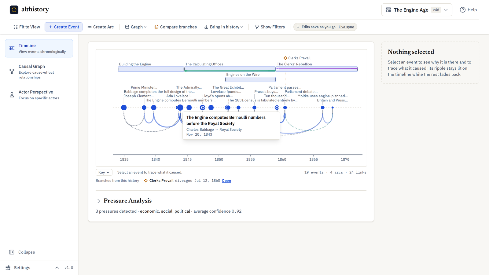
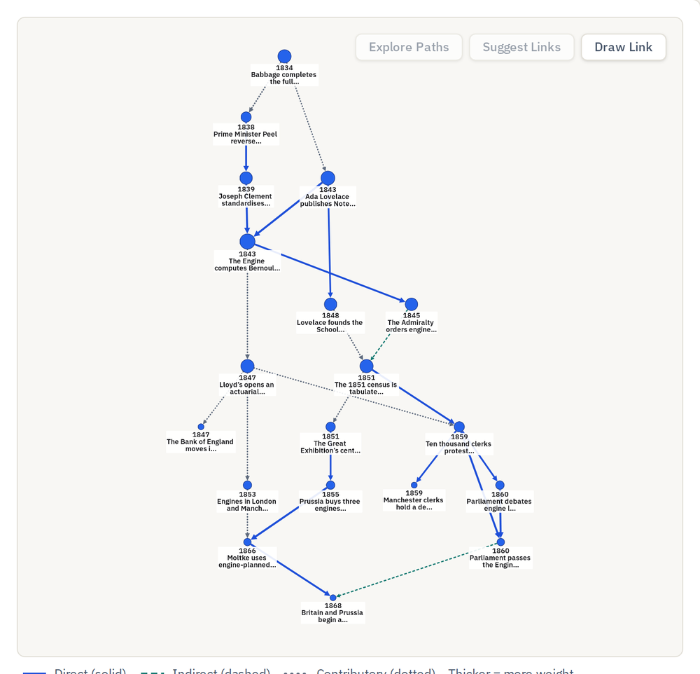
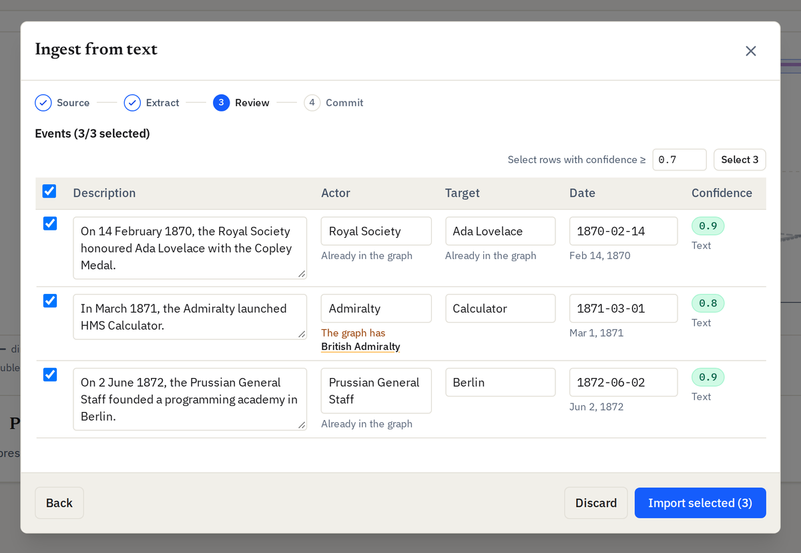
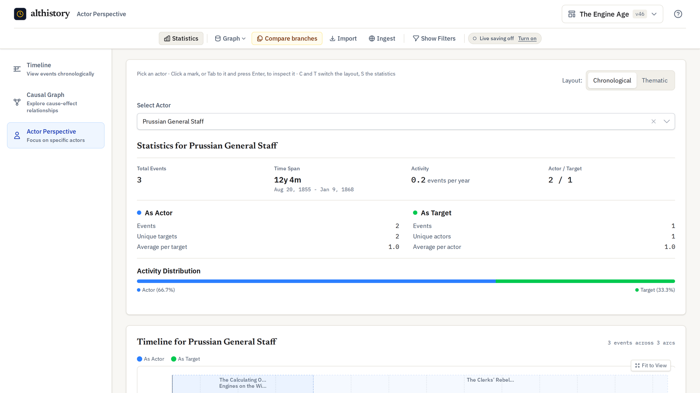
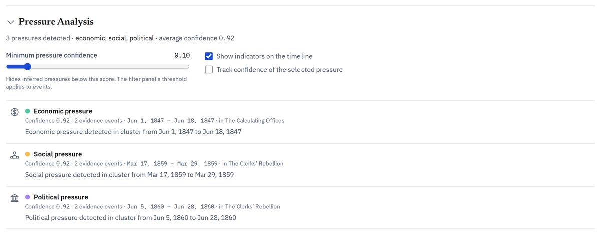

# althistory

Generating historical-ish timelines and events for real and fictional places:
a versioned, multi-graph timeline backend with a React interface and an
agent-first CLI / MCP server for exploring events, arcs, causal chains, and
counterfactual branches.

**[qworg.github.io/althistory](https://qworg.github.io/althistory/)**: the project page.



https://github.com/user-attachments/assets/f83f1c6f-eca4-468e-9eba-96d43a8c9c88

**New here?** Watch the one-minute walkthrough above
([download it](docs/media/walkthrough.mp4)) or read the [illustrated tour](docs/walkthrough.md). Every picture on this page
is generated from the running app; see [Screenshots and video](#screenshots-and-video).

## A look around

| | |
| --- | --- |
|  |  |
| **Causal graph**: every cause-and-effect link, weighted and typed, in a choice of layouts. | **Ingestion**: extract events from Wikipedia, Wikidata or text, and review them before anything is written. |
|  |  |
| **Actor perspective**: one actor's events, as actor and as target. | **Inferred pressures**: economic, social and political pressures read from clusters of events. |

## Layout

| Path | What it is |
| --- | --- |
| `timeline/` | Express + TypeScript API and CLI (`bin/althistory`). Versioned graph storage (Git-like trees), export/import, inference, ingestion, WebSocket streaming, MCP server. |
| `frontend/` | React + Vite UI. Timeline, causal graph, actor and pressure views, graph/version/import/export panels. |
| `e2e/` | Playwright end-to-end and visual-regression tests against a production build with the API stubbed. |
| `media/` | The generator for the README screenshots and the walkthrough video (Playwright + [Revideo](https://github.com/midrender/revideo)). |
| `docs/` | API integration, export format, ingestion, branch/merge, MCP, production deployment, the D3/React architecture decision, and the feature requirements (`docs/specs/`). |
| `docker/`, `docker-compose.yml`, `Dockerfile` | Container images and the production stack. |

## Prerequisites & Installation

- **Node.js** >= 20 (Node 22/24 recommended) and `npm`

Install workspace dependencies from the repository root:

```bash
npm install
```

## Quick start (no Neo4j or Redis)

```bash
./start-local.sh
```

Then open http://localhost:5173. On first run the script writes
`timeline/.env.local` and `frontend/.env.local` (mode 600) with an admin API
key generated for this install; the frontend sends it with every request.

Local mode needs no API key for the entity routes by default, so the backend
listens on `127.0.0.1` only. Run `--tailscale` to listen on `0.0.0.0` and print
your Tailscale URLs:

```bash
./start-local.sh --tailscale
```

Every device on the tailnet can then read and change your timelines. Add
`API_AUTH_REQUIRED=true` to `timeline/.env.local` if that is not what you want.

Or run the two packages by hand:

```bash
cd timeline && echo "LOCAL_EXECUTION_ENABLED=true" > .env.local && npm run dev   # port 3000
cd frontend && npm run dev                                                      # port 5173
```

Local mode stores graphs, versions and jobs as JSON under `LOCAL_DATA_DIR`
(default `./data`). Cloud mode (`LOCAL_EXECUTION_ENABLED=false`) puts the
entities in Neo4j and uses Redis, but graph metadata, jobs, versions and API
keys are still files, and the rate-limit counters are per process — so cloud
mode is **one replica with a persistent volume** and refuses to start without
`CLOUD_SINGLE_REPLICA_STATE=true`. See
[`docs/production-deployment.md`](docs/production-deployment.md#4-state-and-persistence).

## Agent CLI & MCP Server

`./bin/althistory` is a scriptable CLI, and `./bin/althistory mcp` a stdio
Model Context Protocol (MCP) server, so an agent such as Claude can write a
history with you: bend a real one at a point of divergence, or invent a world
with no real history under it. The agent does the writing through the tools;
althistory keeps the events, ages and causes in a graph, refuses a cause dated
after its effect, validates the whole, and branches it at any event. Both
connect to a running app on `http://localhost:3000` (so changes appear live in
the web UI) or fall back to the local files (`--direct`).

Register the server with your client (more in
[`docs/mcp-agent-guide.md`](docs/mcp-agent-guide.md) and [`.mcp/`](.mcp/)):

```bash
npm link   # puts althistory on your PATH
claude mcp add --scope user althistory -- althistory mcp   # Claude Code
```

```json
{ "mcpServers": { "althistory": { "command": "althistory", "args": ["mcp"] } } }
```

The server offers three prompts, one for each way of working (in Claude Code,
`/althistory:worldbuild` and so on; run one, then describe your world or
premise in your next message):

| Prompt | For |
| --- | --- |
| `worldbuild` | An invented world: its calendar, ages, events and causes. |
| `alternate_history` | Real history turned at one moment, grounded in what really happened before it. |
| `grow_history` | Extending a graph you already have, and branching where it forks. |

An invented world gets its own **calendar**: the graph records which stored
year is the world's year 1 (`epochYear`) and a label (`eraLabel`), and the app
and the exports show "Mar 4, 312 AR" instead of 1311. Dates stay ISO 8601
underneath, so sorting and validation are unchanged.

`generate timeline` (and the `generate_timeline` tool) drafts a graph
whole-cloth from a premise or a world description. It uses a model only when
*the althistory process* has `ANTHROPIC_API_KEY` or `OPENAI_API_KEY`; without
one it returns a template skeleton, and the result says
`"source": "template"`. Generation runs in-process, so it needs the app
stopped: with the app running, the CLI works through it (using the app's own
key from `timeline/.env.local`), and the app has no generation route. Don't
add `--direct` while the app runs; two processes would write the same files.

```bash
./bin/althistory schema                 # the JSON Schema of every command
./bin/althistory schema --mcp           # the MCP tools

# An invented world
./bin/althistory graph create "Vael" --epoch-year 1000 --era-label AR
./bin/althistory generate timeline --world "A drowned archipelago ruled by salt-kings" --era-label AR   # app stopped
./bin/althistory prompt worldbuild world="A drowned archipelago" --plain   # the brief, for any agent

# Real and alternate history
./bin/althistory ingest url "https://en.wikipedia.org/wiki/Battle_of_Hastings" -g <graphId>
./bin/althistory generate timeline --premise "Byzantium wins at Manzikert" --divergence-point "1071-08-26"   # app stopped
./bin/althistory generate simulate -g <graphId> --steps 3 --months 12
./bin/althistory validate <graphId> --auto-repair
./bin/althistory --plain export <graphId> --format markdown
```

The [project page](https://qworg.github.io/althistory/agents.html) walks
through building a world with Claude, and the
[demo](https://qworg.github.io/althistory/demo/?start=world) opens the result.

## Tests

```bash
./run-tests.sh            # backend + frontend unit/integration suites
```

```bash
cd timeline && npm test   # 100 files (2,051 tests)
cd frontend && npm test   # 116 files (1,746 tests)
```

End-to-end, against a real browser and a production build (API stubbed):

```bash
cd e2e
npm ci
npx playwright install chromium
npx playwright test
```

CI (`.github/workflows/ci.yml`) gates both packages on typecheck, ESLint, the
test suites with coverage, the frontend production build, and the non-visual
Playwright specs.

## Screenshots and video

The images in this README, [`docs/walkthrough.md`](docs/walkthrough.md) and
the walkthrough video are generated, not hand-made. Rerun the generator
whenever the interface changes and commit what it writes:

```bash
cd media
npm ci
npx playwright install chromium   # once
npm run generate                  # ~2 min: build, seed, capture, render
```

It builds the backend and frontend, starts them privately on free ports with
a throwaway data directory, seeds a curated demo graph through the API, drives
the real app with Playwright, and renders the video with
[Revideo](https://github.com/midrender/revideo). It writes
`docs/images/*.png` and `docs/media/walkthrough.mp4`, and touches nothing
else: not your data, your ports, or `frontend/dist`. See
[`media/README.md`](media/README.md) to change the tour or the narration.

## Configuration

Frequently used variables; the full set with defaults and validation lives in
`timeline/src/utils/config.ts`.

| Variable | Default | Purpose |
| --- | --- | --- |
| `LOCAL_EXECUTION_ENABLED` | `false` | Use the local JSON store instead of Neo4j/Redis |
| `HOST` | `127.0.0.1` in local mode, else `0.0.0.0` | Interface the API listens on. `TAILSCALE=true` (set by `--tailscale`) also selects `0.0.0.0` |
| `API_AUTH_REQUIRED` | `true`; `false` in local mode | Whether the entity routes (`/api/events`, `/api/arcs`, …) need an API key |
| `ADMIN_API_KEY` | generated | Admin key, registered on any start where the key store does not already hold it. The API refuses to start on a `CHANGE_ME…` placeholder, as it does for `NEO4J_PASSWORD` and `REDIS_PASSWORD` |
| `TRUST_PROXY` | `false` | Express `trust proxy` (`1` = one reverse-proxy hop). Set only when every request comes through that proxy; the compose stack sets `1` |
| `LOCAL_DATA_DIR` | `./data` | Where local graphs, versions, jobs and exports live |
| `NEO4J_URI`, `NEO4J_USERNAME`, `NEO4J_PASSWORD` | — | Cloud-mode graph store |
| `REDIS_HOST`, `REDIS_PORT`, `REDIS_PASSWORD` | `localhost:6379` | Cloud-mode cache and rate-limit snapshot |
| `CLOUD_SINGLE_REPLICA_STATE` | — | **Required in cloud mode.** Confirms the deployment is one replica with a persistent volume; the API refuses to start without it |
| `LOCAL_MAX_MEMORY_MB` | `512` | Local store memory ceiling (minimum 64) |
| `WIKIMEDIA_CONTACT` | — | Your email or `User:Name`, added to the User-Agent sent to Wikipedia and Wikidata (Wikimedia asks for a contact) |
| `INGEST_TIMEOUT_MS` | `300000` | Request budget for `/api/ingest`; everything else keeps `QUERY_TIMEOUT_MS` (2 s) |
| `LOCAL_EXPORT_ASYNC_ENTITY_THRESHOLD` | `10000` | Entity count above which an export becomes an async job |

## API description

The HTTP API is described by an OpenAPI 3 document, generated from the route
table so it cannot describe a route that is not mounted:

```bash
curl http://localhost:3000/api/openapi.json
```

A route that is added without a description fails the backend test suite
(`src/api/openapi/openapi.test.ts`) — the description of each operation is
hand-written in `timeline/src/api/openapi/operations.ts`, and the document
builder refuses to describe a route that has no entry there.

## Documentation

- [`docs/walkthrough.md`](docs/walkthrough.md) — an illustrated tour of the interface for new users.
- [`AGENTS.md`](AGENTS.md) — code style, architecture rules and build commands.
- [`CLAUDE.md`](CLAUDE.md) — developer and agent quick reference.
- [`docs/api-integration.md`](docs/api-integration.md) — using the API from outside: keys, permissions, graph scoping, rate limits, jobs and webhooks.
- [`docs/export-format.md`](docs/export-format.md) — the export document field by field, and how to verify its checksum.
- [`docs/ingestion.md`](docs/ingestion.md) — getting history in: CLI, API, the review step, and what the LLM modes cost.
- [`docs/branch-merge-resolver.md`](docs/branch-merge-resolver.md) — combining two graphs and the anomalies the merge checks.
- [`docs/mcp-agent-guide.md`](docs/mcp-agent-guide.md) — MCP server tools and agent workflow guide.
- [`docs/autonomous-simulation-engine.md`](docs/autonomous-simulation-engine.md) — autonomous multi-step timeline simulation engine.
- [`docs/production-deployment.md`](docs/production-deployment.md) — container, cloud stack, and operational procedures.
- [`docs/adr-001-d3-react-integration.md`](docs/adr-001-d3-react-integration.md) — which timeline components React renders and which D3 owns.
- [`docs/specs/`](docs/specs/) — feature requirements; the `Req N` numbers in code comments refer to these.
- `GET /api/openapi.json` — the authoritative HTTP route list.
- [`e2e/README.md`](e2e/README.md) — end-to-end and visual-regression workflow.
- [`media/README.md`](media/README.md) — the screenshot and walkthrough-video generator.

## License

Released under the [MIT License](LICENSE).
