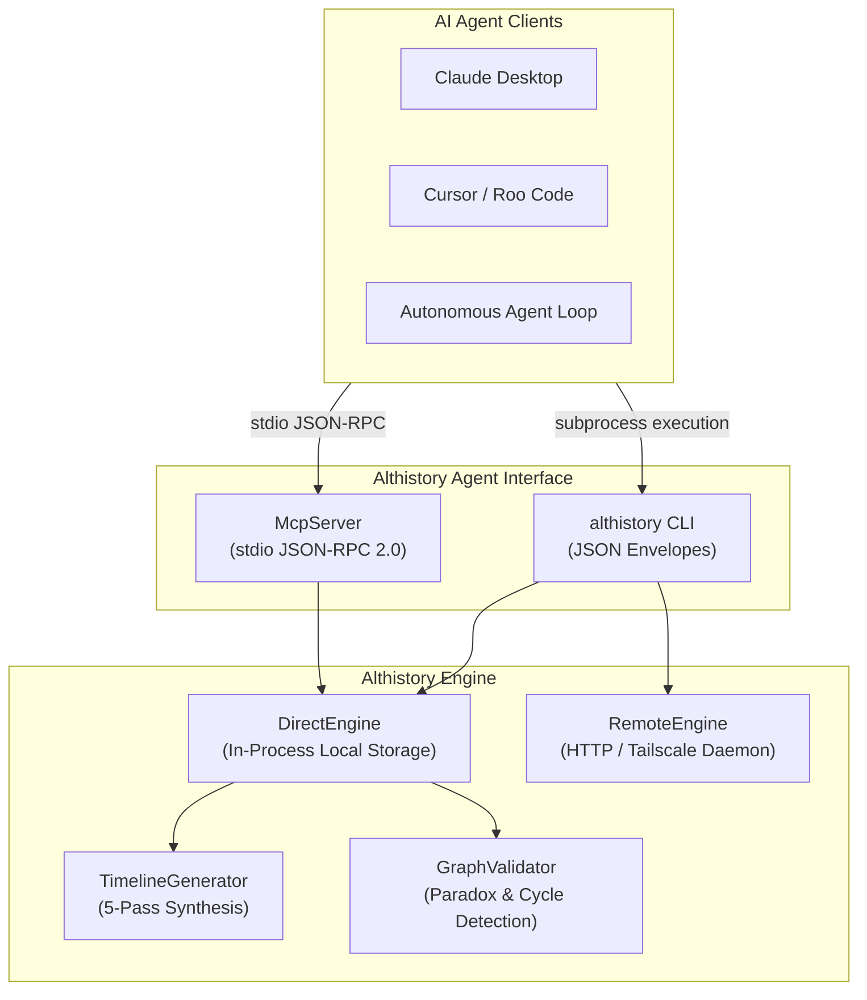

# Althistory Agent Integration & Model Context Protocol (MCP) Guide

This guide explains how AI agents (including Anthropic Claude Desktop, Google Antigravity, Cursor, Roo Code, and autonomous LLM pipelines) connect to and interact with the **Althistory** temporal and causal history platform.

---

## 1. Architecture Overview

Althistory provides an **Agent-First Interface** designed specifically for LLMs to generate counterfactual histories whole-cloth, ingest historical sources, query causal reasoning paths, and validate timeline consistency.



### Protocol Standards
- **Transport:** Standard input/output (`stdio`) JSON-RPC 2.0.
- **Protocol Version:** MCP `2024-11-05`.
- **Output Purity:** All operational diagnostics, log messages, and debug traces are strictly directed to `stderr`. `stdout` carries exclusively clean JSON-RPC protocol frames or machine-readable JSON envelopes.
- **Execution Modes:**
  - **Direct Mode (`--direct`):** In-process execution using local JSON storage (`timeline/data`), requiring no external daemon or network sockets.
  - **Remote Mode (`--url <daemon-url>`):** Connects to a running Althistory server (local, LAN, or Tailscale node).

---

## 2. MCP Client Configuration

### A. Claude Desktop
Add the following to your `claude_desktop_config.json` (`~/.config/Claude/claude_desktop_config.json` on Linux or `~/Library/Application Support/Claude/claude_desktop_config.json` on macOS):

```json
{
  "mcpServers": {
    "althistory": {
      "command": "althistory",
      "args": ["mcp"],
      "env": {
        "LOCAL_EXECUTION_ENABLED": "true"
      }
    }
  }
}
```

### B. Cursor / Roo Code / Cline
In `.cursor/mcp.json` or your extension settings:

```json
{
  "mcpServers": {
    "althistory": {
      "command": "althistory",
      "args": ["mcp"]
    }
  }
}
```

### C. Direct Project Execution (No Global Link)
If `althistory` is not in your global `PATH`, use the repository path directly:

```json
{
  "mcpServers": {
    "althistory": {
      "command": "/path/to/althistory/bin/althistory",
      "args": ["mcp"]
    }
  }
}
```

---

## 3. Available MCP Tools Reference

The Althistory MCP server exposes 8 typed tools:

### 1. `althistory_list_graphs`
List all accessible historical timeline graphs.
- **Parameters:** None.
- **Returns:** Array of graphs with `id`, `name`, `description`, and `updated_at`.

### 2. `althistory_create_event`
Create a historical or counterfactual milestone event within a timeline.
- **Parameters:**
  - `graphId` *(string, required)*: Target graph ID.
  - `description` *(string, required)*: Event description.
  - `timestamp` *(string, required)*: ISO 8601 timestamp.
  - `actor` *(string, optional)*: Key actor or entity.
  - `target` *(string, optional)*: Affected entity or target.
  - `arcId` *(string, optional)*: Narrative arc ID.

### 3. `althistory_ingest_text`
Ingest raw historical text and extract chronological milestone events.
- **Parameters:**
  - `text` *(string, required)*: Historical prose to ingest.
  - `graphId` *(string, optional)*: Target graph ID (creates new graph if omitted).
  - `graphName` *(string, optional)*: Name for a new graph.
  - `groupArcs` *(boolean, optional)*: Automatically cluster into narrative arcs.
  - `inferCauses` *(boolean, optional)*: Automatically infer causal links.

### 4. `althistory_generate_timeline`
Generate a whole-cloth counterfactual timeline from a what-if premise.
- **Parameters:**
  - `premise` *(string, required)*: Core counterfactual premise (e.g. *"The Library of Alexandria survives intact"*).
  - `divergencePoint` *(string, required)*: Historical pivot where history diverges.
  - `startDate` *(string, optional)*: Beginning timestamp (ISO 8601).
  - `endDate` *(string, optional)*: Ending timestamp (ISO 8601).
  - `eventCount` *(number, optional)*: Target event count (default: 8).
  - `style` *(string, optional)*: `"academic"` | `"narrative"` | `"concise"`.
  - `dryRun` *(boolean, optional)*: Preview without persisting.

### 5. `althistory_branch_timeline`
Branch an existing timeline at a specific counterfactual pivot event.
- **Parameters:**
  - `sourceGraphId` *(string, required)*: Source graph to branch from.
  - `pivotEventId` *(string, required)*: Event ID where the branch diverges.
  - `divergencePremise` *(string, required)*: Description of how events diverge.
  - `branchName` *(string, optional)*: Name of the new branch graph.

### 6. `althistory_query_causal_path`
Trace directed cause-and-effect paths and reasoning chains between two events.
- **Parameters:**
  - `graphId` *(string, required)*: Graph ID.
  - `sourceEventId` *(string, required)*: Root cause event ID.
  - `targetEventId` *(string, required)*: Consequential effect event ID.
  - `maxDepth` *(number, optional)*: Maximum path hops (default: 10).

### 7. `althistory_validate_graph`
Audit timeline for causal paradoxes, inverted chronology, and arc boundary containment.
- **Parameters:**
  - `graphId` *(string, required)*: Graph ID to validate.
  - `strict` *(boolean, optional)*: Treat warnings as failures.
  - `autoRepair` *(boolean, optional)*: Automatically repair anomalies (clamp arc bounds, prune cycle edges).

### 8. `althistory_export_context`
Export timeline context formatted for LLM prompts, Markdown tables, or Graphviz visualization.
- **Parameters:**
  - `graphId` *(string, required)*: Graph ID to export.
  - `format` *(string, optional)*: `"markdown"` | `"json"` | `"dot"` (default: `"markdown"`).

---

## 4. Tailscale & Remote Network Access

When running the Althistory daemon across a Tailnet:
1. Start the server with Tailscale enabled:
   ```bash
   ./start-local.sh --tailscale
   # or
   npm run dev:tailscale
   ```
2. The server binds to `0.0.0.0` and prints the Tailscale access coordinates (e.g. `http://100.102.29.81:3000`).
3. Remote agents connect via CLI:
   ```bash
   althistory --url http://100.102.29.81:3000 --api-key <your-key> graph list
   ```
4. Remote web browsers on your Tailnet access the interactive D3/Cytoscape visualizer at `http://100.102.29.81:5173`.
