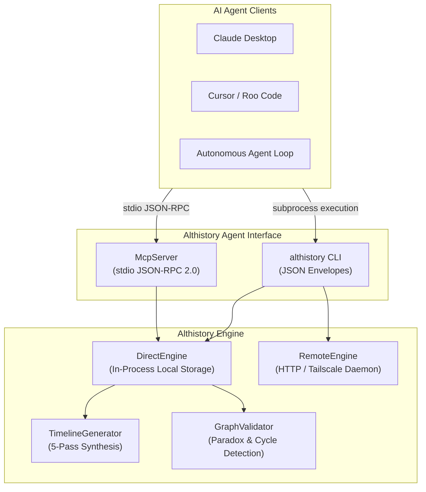

# Althistory Agent Integration & Model Context Protocol (MCP) Guide

This guide explains how AI agents (including Anthropic Claude Desktop, Google Antigravity, Cursor, Roo Code, and autonomous LLM pipelines) connect to and interact with the **Althistory** temporal and causal history platform.

---

## 1. Architecture Overview

Althistory provides an **Agent-First Interface** designed specifically for LLMs to write histories (real, alternate, or of invented worlds with their own calendars) by hand or whole-cloth, ingest historical sources, query causal reasoning paths, and validate timeline consistency.



### Protocol Standards
- **Transport:** Standard input/output (`stdio`) JSON-RPC 2.0.
- **Protocol Version:** MCP `2024-11-05`.
- **Capabilities:** `tools` and `prompts`.
- **Output Purity:** All operational diagnostics, log messages, and debug traces are strictly directed to `stderr`. `stdout` carries exclusively clean JSON-RPC protocol frames or machine-readable JSON envelopes.
- **Execution Modes:**
  - **Direct Mode (`--direct`):** In-process execution using local JSON storage (`timeline/data`), requiring no external daemon or network sockets.
  - **Remote Mode (`--url <daemon-url>`):** Connects to a running Althistory server (local, LAN, or Tailscale node).

---

## 2. MCP Client Configuration

### A. Claude Desktop
Add the following to your `claude_desktop_config.json` (`~/.config/Claude/claude_desktop_config.json` on Linux or `~/Library/Application Support/Claude/claude_desktop_config.json` on macOS):

```json
{
  "mcpServers": {
    "althistory": {
      "command": "althistory",
      "args": ["mcp"],
      "env": {
        "LOCAL_EXECUTION_ENABLED": "true"
      }
    }
  }
}
```

### B. Cursor / Roo Code / Cline
In `.cursor/mcp.json` or your extension settings:

```json
{
  "mcpServers": {
    "althistory": {
      "command": "althistory",
      "args": ["mcp"]
    }
  }
}
```

### C. Claude Code

```bash
claude mcp add althistory -e LOCAL_EXECUTION_ENABLED=true -- althistory mcp
```

The prompts then appear as `/mcp__althistory__worldbuild`,
`/mcp__althistory__alternate_history` and `/mcp__althistory__grow_history`.

### D. Direct Project Execution (No Global Link)
If `althistory` is not in your global `PATH`, use the repository path directly:

```json
{
  "mcpServers": {
    "althistory": {
      "command": "/path/to/althistory/bin/althistory",
      "args": ["mcp"]
    }
  }
}
```

---

## 3. Three ways to work

The server offers one prompt for each way of working (MCP `prompts/list`). A
client shows them to its user; Claude Code lists them as slash commands
(`/mcp__althistory__worldbuild`). Without MCP, `althistory prompt <name>
key=value… --plain` prints the same text for any agent that can run a command.

| Prompt | Arguments | For |
| --- | --- | --- |
| `worldbuild` | `world` (required), `eraLabel`, `epochYear` | An invented world with no real history under it: calendar, ages, events, causes, checked as it goes. |
| `alternate_history` | `premise` (required), `divergencePoint` | Real history turned at one moment: a draft, grounded in what really happened before the turn, then branched. |
| `grow_history` | `graphId` (required) | A graph you already have: read it, extend one thread (writing or simulating), validate, branch. |

### Inventing a world

An invented world has no real dates, but every timestamp is still an ISO 8601
instant, because sorting, validation and the causal-order checks all read
them. A **world calendar** on the graph relabels the year when a date is shown:

```json
{ "epochYear": 1000, "eraLabel": "AR", "name": "the Reckoning of the Rising" }
```

`epochYear` is the stored year that is the world's year 1, so the world's year
N is stored as year N + epochYear − 1: with the calendar above, 312 AR is
stored as 1311. The app, the Markdown export and `althistory_export_context`
show "Mar 4, 312 AR"; the export also gives the stored date and the offset, so
an agent writing new events knows what to send. Without `eraLabel` a year reads
"Year 312". Years before the epoch count back ("1 before AR"). Months and days
are shown as stored. Choose an epoch of 1000 or later: some date libraries
read years below 100 as 19xx.

The calendar is kept when the graph is branched or copied, travels in the
export document's `metadata.calendar`, and comes back on import.

A session that builds a world by hand:

1. `althistory_create_graph` with `epochYear` (and `eraLabel`, `calendarName`).
2. `althistory_create_arc` for each age; `parentArcId` nests a reign inside an age.
3. `althistory_create_event` for each event, with `arcId` to place it.
4. `althistory_link_events` from each cause to its effect. A cause dated after
   its effect is refused, and the refusal is usually a question about the
   history rather than a typo.
5. `althistory_validate_graph`, then `althistory_export_context` to read it back.
6. `althistory_branch_timeline` at an event, to explore another course. A branch
   of a world stays in that world and its calendar.

`althistory_generate_timeline` with `world` drafts a skeleton instead: a model
writes it when the server has `ANTHROPIC_API_KEY` or `OPENAI_API_KEY`, told
that the world is not Earth and how its years are stored; without a key it is a
template of ages to rewrite. Ingesting prose about a world (`althistory_ingest_text`
into a graph with a calendar) tells the model the calendar too; the offline
pattern reader cannot read invented years, so give it ISO dates or use a model.

---

## 4. Available MCP Tools Reference

The server exposes 14 tools. `althistory schema --mcp` prints their JSON
schemas. A required argument that is missing is refused by name. Every
timestamp is an ISO 8601 stored date (see the calendar above).

### Reading

#### `althistory_list_graphs`
List the graphs, with their calendars. No parameters.

#### `althistory_export_context`
Read a whole graph back.
- `graphId` *(required)*
- `format`: `"markdown"` (default: arcs, events with their arc and what they lead to, causal links with reasoning, dated in the world's calendar when there is one) | `"json"` (the [export document](export-format.md)) | `"dot"`.

#### `althistory_query_causal_path`
Every causal path from one event to another.
- `graphId`, `fromEventId`, `toEventId` *(all required)*

### Writing by hand

#### `althistory_create_graph`
Create an empty graph to write into.
- `name` *(required)*, `description`
- `epochYear`, `eraLabel`, `calendarName`: an invented world's calendar. A label or name needs `epochYear`.

#### `althistory_set_calendar`
Give a graph a world calendar, change it, or remove it.
- `graphId` *(required)*
- `epochYear`, `eraLabel`, `calendarName`; or `clear` set to `true` to remove it (not both).

#### `althistory_create_arc`
An age, era, reign or campaign that holds events.
- `graphId`, `name`, `startTime`, `endTime` *(required)*
- `description`, `parentArcId` (the arc it sits inside; it is placed one level below it).

#### `althistory_create_event`
- `graphId`, `description`, `timestamp` *(required)*
- `actor`, `target`, `arcId` (puts the event in that arc; if that fails, the error names the event that was created).

#### `althistory_assign_to_arc`
Put an existing event inside an arc.
- `graphId`, `eventId`, `arcId` *(required)*

#### `althistory_link_events`
Record that one event caused another.
- `graphId`, `causeId`, `effectId` *(required)*
- `type`: `"direct"` (default) | `"indirect"` | `"contributory"`
- `weight`: 0 to 1 (default 1)
- `reasoning`: why, in a sentence.

### Generating

#### `althistory_generate_timeline`
Draft a new graph whole-cloth. Give **either** `premise` and `divergencePoint`
(an alternate history) **or** `world` (an invented world), not both.
- `premise`, `divergencePoint`: the what-if, and where real history turns.
- `world`: the world in a few sentences. The graph gets a calendar: `epochYear` defaults to the start date's year, or 1000; `eraLabel` and `calendarName` as above. A calendar on an alternate history is refused.
- `startDate`, `endDate`: ISO 8601. An alternate history defaults to 15 years from the year in the premise; a world to 300 years from its epoch.
- `eventCount` (default 8), `style`: `"academic"` | `"narrative"` | `"concise"`, `dryRun`.

#### `althistory_branch_timeline`
Branch a graph at one of its events and draft a different course from there.
- `sourceGraphId`, `divergeAtEventId`, `counterfactualPrompt`, `branchName` *(required)*
- `eventCount` (default 5), `dryRun`.

#### `althistory_simulate_timeline`
Evolve a graph forward from an event, synthesising pressure-driven events and causal links.
- `graphId` *(required)*
- `steps` (1–10, default 3), `timeAdvanceMonths` (default 12), `anchorEventId` (default: the latest event)
- `domain`: `"political"` | `"military"` | `"economic"` | `"scientific"` | `"social"` | `"environmental"`
- `aggressiveness` (0–1, default 0.5), `seedContext`, `dryRun`.

#### `althistory_ingest_text`
Extract events, arcs and causal links from prose.
- `text` *(required)*, `graphId` (a new graph when omitted)
- `mode`: `"pattern"` | `"llm"` | `"hybrid"` (default)
- `groupArcs`, `inferCauses` (default true), `dryRun`.

### Checking

#### `althistory_validate_graph`
Inverted chronology, causes after their effects, arcs that do not contain their events, cycles.
- `graphId` *(required)*, `strict` (warnings fail too), `autoRepair` (clamp arc bounds, prune cycle edges).

---

## 5. Tailscale & Remote Network Access

When running the Althistory daemon across a Tailnet:
1. Start the server with Tailscale enabled:
   ```bash
   ./start-local.sh --tailscale
   # or
   npm run dev:tailscale
   ```
2. The server binds to `0.0.0.0` and prints the Tailscale access coordinates (e.g. `http://100.x.y.z:3000`, where `100.x.y.z` is the machine's Tailscale IP).
   Local mode does not require an API key by default (`API_AUTH_REQUIRED` is `false`), so every device on the tailnet can read and change the events, arcs and relationships in your graphs. Set `API_AUTH_REQUIRED=true` in `timeline/.env.local` if that is not what you want.
3. Remote agents connect via CLI:
   ```bash
   althistory --url http://100.x.y.z:3000 --api-key <your-key> graph list
   ```
4. Remote web browsers on your Tailnet access the interactive D3/Cytoscape visualizer at `http://100.x.y.z:5173`.
