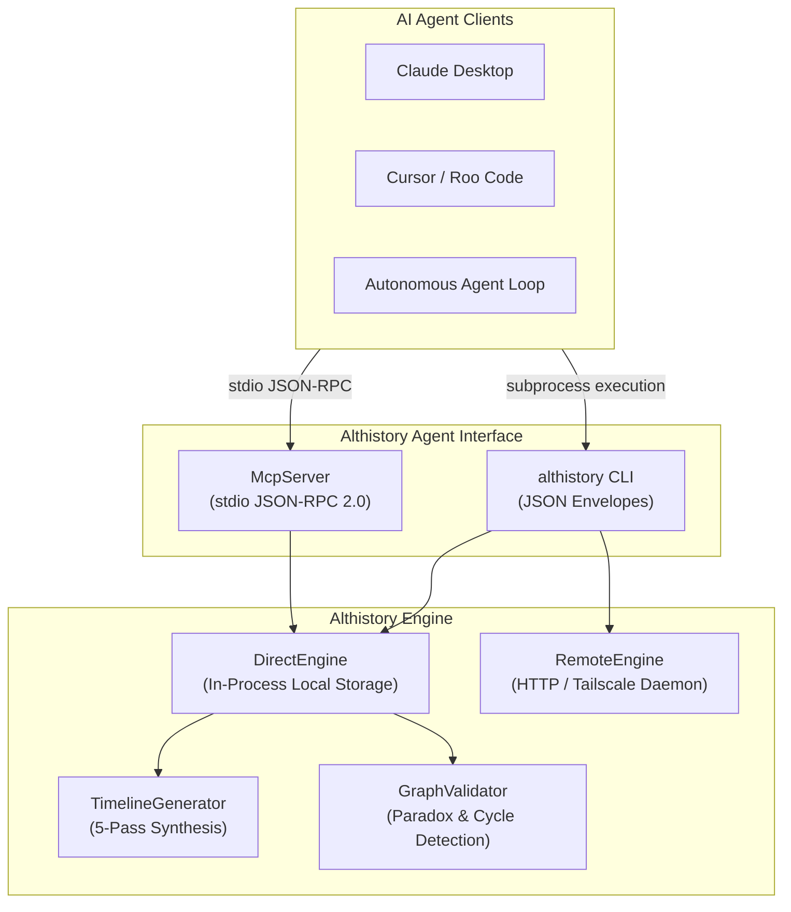

# Althistory Agent Integration & Model Context Protocol (MCP) Guide

This guide explains how AI agents (including Anthropic Claude Desktop, Google Antigravity, Cursor, Roo Code, and autonomous LLM pipelines) connect to and interact with the **Althistory** temporal and causal history platform.

---

## 1. Architecture Overview

Althistory provides an **Agent-First Interface** designed specifically for LLMs to write histories (real, alternate, or of invented worlds with their own calendars) by hand or whole-cloth, ingest historical sources, query causal reasoning paths, and validate timeline consistency.



### Protocol Standards
- **Transport:** Standard input/output (`stdio`) JSON-RPC 2.0.
- **Protocol Version:** MCP `2024-11-05`.
- **Capabilities:** `tools` and `prompts`.
- **Output Purity:** All operational diagnostics, log messages, and debug traces are strictly directed to `stderr`. `stdout` carries exclusively clean JSON-RPC protocol frames or machine-readable JSON envelopes.
- **Execution Modes:**
  - **Direct Mode (`--direct`):** In-process execution using local JSON storage (`timeline/data`), requiring no external daemon or network sockets.
  - **Remote Mode (`--url <daemon-url>`):** Connects to a running Althistory server (local, LAN, or Tailscale node).

---

## 2. MCP Client Configuration

`npm link` in the clone puts `althistory` on your PATH. If your client cannot
find it (Claude Desktop on macOS starts with a minimal PATH), give the full
path to `bin/althistory` in the clone instead; it runs through `npx`, so
`node` must be on the client's PATH.

When the althistory app is running on `127.0.0.1:3000`, the server works
through it, so what an agent writes appears in the app as it goes; otherwise
it works on the local files (`timeline/data`, the same store the app reads).
`althistory_generate_timeline` and `althistory_branch_timeline` run only
in-process, so they need the app stopped; every other tool works either way.
Do not add `--direct` while the app is running: two processes would then
write the same files. Working through the app, the server uses
`ALTHISTORY_API_KEY` if its `env` sets one (give an agent a scoped key that
way), and otherwise the app's own admin key, which `start-local.sh` writes to
`timeline/.env.local`. For another server, also pass `--url`.

To let the server draft with a model, give **the server** a key: add
`ANTHROPIC_API_KEY` (or `OPENAI_API_KEY`) to its `env`. The agent's own model
does not count. Without one, generation returns a template marked
`"source": "template"`.

### A. Claude Desktop / Cursor / Roo Code / Cline
`claude_desktop_config.json` (`~/.config/Claude/` on Linux,
`~/Library/Application Support/Claude/` on macOS), `.cursor/mcp.json`, or your
extension's settings:

```json
{
  "mcpServers": {
    "althistory": {
      "command": "althistory",
      "args": ["mcp"],
      "env": { "ANTHROPIC_API_KEY": "<your key>" }
    }
  }
}
```

The `env` line is only for drafting with a model; leave it out otherwise.

### B. Claude Code

```bash
claude mcp add --scope user althistory -- althistory mcp
```

`--scope user` makes the tools available in every project; without it they
exist only in the directory you ran it in. Claude Code lists the prompts as
`/althistory:worldbuild`, `/althistory:alternate_history` and
`/althistory:grow_history` (typing `/mcp__althistory__worldbuild` works too).
It passes a slash command's words to the prompt's arguments in order, split
on whitespace, so run the prompt on its own (or with the one-word arguments:
`/althistory:worldbuild AR 1000`) and describe the world in your next message.

---

## 3. Three ways to work

The server offers one prompt for each way of working (MCP `prompts/list`). A
client shows them to its user (Claude Code: `/althistory:worldbuild`). Every
argument is optional: the prompt tells the agent to ask for what is missing.
Without MCP, `althistory prompt <name> key=value… --plain` prints the same
text for any agent that can run a command.

| Prompt | Arguments, in order | For |
| --- | --- | --- |
| `worldbuild` | `eraLabel`, `epochYear`, `world` | An invented world with no real history under it: calendar, ages, events, causes, checked as it goes. |
| `alternate_history` | `premise`, `divergencePoint` | Real history turned at one moment: a draft, grounded in what really happened before the turn, then branched. |
| `grow_history` | `graphId` | A graph you already have: read it, extend one thread, validate, branch. Without an id the agent lists the graphs and asks. |

### Inventing a world

An invented world keeps its own time. Every event still sits at a position on
one linear timeline (its `timestamp`), because sorting, validation and the
causal-order checks read positions. The graph's **world calendars** name those
positions in the world's own terms, and they can have any shape: any number of
months of any length, festival days that belong to no month, leap rules,
weeks, a day of the world's own length divided into its own hours, eras
counted up and back, and several calendars at once (two cultures' reckonings
of the same days). The full description is in
[`docs/specs/world-calendars.md`](specs/world-calendars.md).

There are two ways to give a graph a calendar:

- **Simple:** `epochYear`, `eraLabel`, `calendarName` and `monthNames`. This is
  the Gregorian calendar with the world's own year count and month names:
  with `{ "epochYear": 1000, "eraLabel": "AR" }`, the position stored as
  1311-03-04 reads "Mar 4, 312 AR". Without `eraLabel` a year reads
  "Year 312"; years before the epoch count back ("1 before AR").
- **Any shape:** `calendar`, a calendar set:

```json
{
  "version": 2,
  "dayLength": 108000,
  "primary": "reckoning",
  "calendars": [{
    "id": "reckoning",
    "name": "the Reckoning of the Rising",
    "parts": [
      { "name": "Lowtide", "days": 30 }, { "name": "Greywater", "days": 30 },
      { "name": "Midyear's Day", "days": 1, "intercalary": true },
      { "name": "Longnight", "days": 30 },
      { "name": "The Drowned Days", "days": 4, "intercalary": true }
    ],
    "leapRules": [{ "every": 6, "part": 4, "days": 1 }],
    "epoch": 0,
    "eras": [{ "label": "AR", "from": 1 }],
    "week": { "days": ["Firstfast", "Netday", "Saltday"], "skipsIntercalary": true },
    "time": { "hoursPerDay": 20, "minutesPerHour": 100, "secondsPerMinute": 100 }
  }]
}
```

Dates then go in and come out in the world's notation. `althistory_create_event`
takes `timestamp: "Greywater 4, 312 AR"` (or an ISO 8601 timestamp), and
`althistory_create_arc` takes the same for `startTime` and `endTime`. A month or a
year alone ("Greywater 312 AR") is stored at its first day, with its precision
recorded; as an arc's `endTime`, a day, month or year written without a time
means its last moment. Every tool result gives an event's date as the world
writes it (`worldDate`) beside its `timestamp`, and an arc's as `worldStart` and
`worldEnd`. These are written only as finely as the world's notation shows a
time (its minutes, say); to keep an exact moment, give the `timestamp`. `althistory_export_context` shows each date in the world's
notation, with its place on the timeline (an ISO 8601 instant) in brackets. Text written about the world, sent to
`althistory_ingest_text` with the graph named, has its dates read in the
world's notation too.

Setting a calendar replaces the whole calendar. Names cannot contain a `|`,
braces or a control character; month, festival and weekday names cannot
contain a comma, brackets or a double quote either, month, festival names
and era labels cannot contain a digit, and each calendar's era labels (and
its name for the years before them) must be its own, not another calendar's
of the world. A set whose text would read back as another date (a festival
"Midyear 3" beside a month "Midyear"; two calendars that both write "Year 5")
is refused, with the text that collides.

The calendar is kept when the graph is branched or copied, travels in the
export document's `metadata.calendar`, and comes back on import.

A session that builds a world by hand:

1. `althistory_create_graph` with `calendar` (or the simple `epochYear`, `eraLabel`, `calendarName`, `monthNames`).
2. `althistory_create_arc` for each age; `parentArcId` nests a reign inside an age.
3. `althistory_create_event` for each event, with `arcId` to place it.
4. `althistory_link_events` from each cause to its effect. A cause dated after
   its effect is refused, and the refusal is usually a question about the
   history rather than a typo.
5. `althistory_validate_graph`, then `althistory_export_context` to read it back.
6. `althistory_branch_timeline` at an event, to explore another course. A branch
   of a world stays in that world and its calendar.

`althistory_generate_timeline` with `world` drafts a skeleton instead: a model
writes it when the server has `ANTHROPIC_API_KEY` or `OPENAI_API_KEY`, told
that the world is not Earth and to date events in the world's own calendar; without a key it is a
template of generic ages to rewrite. The result's `source` says which.

Give `reasoning` on every `althistory_link_events` call: without it the link
records "Observed historical causality", which reads oddly in a world nobody
observed. Ingesting prose about a world (`althistory_ingest_text`
into a graph with a calendar) tells the model the calendar too; the offline
pattern reader cannot read invented years, so give it ISO dates or use a model.

---

## 4. Available MCP Tools Reference

The server exposes 14 tools. `althistory schema --mcp` prints their JSON
schemas. A required argument that is missing is refused by name. Every
`timestamp` a tool returns is an ISO 8601 stored date (see the calendar
above); a date a tool takes is ISO 8601, year-first text without a world, or
in a world its notation, as each tool below says.

### Reading

#### `althistory_list_graphs`
List the graphs, with their calendars. No parameters.

#### `althistory_export_context`
Read a whole graph back.
- `graphId` *(required)*
- `format`: `"markdown"` (default: arcs, events with their arc and what they lead to, causal links with reasoning, dated in the world's calendar when there is one) | `"json"` (the [export document](export-format.md)) | `"dot"`.

#### `althistory_query_causal_path`
Every causal path from one event to another.
- `graphId`, `fromEventId`, `toEventId` *(all required)*

### Writing by hand

#### `althistory_create_graph`
Create an empty graph to write into.
- `name` *(required)*, `description`
- `epochYear`, `eraLabel`, `calendarName`, `monthNames`: a simple world calendar (the Gregorian one with the world's year count and month names). A label, name or month names need `epochYear`. `monthNames` is a list of twelve.
- `calendar`: instead, world calendars of any shape (a calendar set; see *Inventing a world*). Not with the simple fields.

#### `althistory_set_calendar`
Give a graph a world calendar, change it, or remove it.
- `graphId` *(required)*
- `epochYear`, `eraLabel`, `calendarName`, `monthNames`; or `calendar` (a calendar set of any shape); or `clear` set to `true` to remove it. The fields given replace the whole calendar, so a field left out is removed.

#### `althistory_create_arc`
An age, era, reign or campaign that holds events.
- `graphId`, `name`, `startTime`, `endTime` *(required)*: ISO 8601 (or, without a world, year first: `312`, `44 BCE`), or in a world graph a date in the world's notation (an `endTime` without a time, a day, month or year, means its last moment).
- `description`, `parentArcId` (the arc it sits inside; it is placed one level below it).

#### `althistory_create_event`
- `graphId`, `description`, `timestamp` *(required)*: ISO 8601 (or, without a world, year first: `312`, `44 BCE`), or in a world graph a date in the world's notation ("Greywater 4, 312 AR"; a month or a year alone records its precision).
- `actor`, `target`, `arcId` (puts the event in that arc; if that fails, the error names the event that was created).

#### `althistory_assign_to_arc`
Put an existing event inside an arc.
- `graphId`, `eventId`, `arcId` *(required)*

#### `althistory_link_events`
Record that one event caused another.
- `graphId`, `causeId`, `effectId` *(required)*
- `type`: `"direct"` (default) | `"indirect"` | `"contributory"`
- `weight`: 0 to 1 (default 1)
- `reasoning`: why, in a sentence.

### Generating

#### `althistory_generate_timeline`
Draft a new graph whole-cloth. Give **either** `premise` and `divergencePoint`
(an alternate history) **or** `world` (an invented world), not both.
- `premise`, `divergencePoint`: the what-if, and where real history turns.
- `world`: the world in a few sentences. The graph gets a calendar: `epochYear` defaults to the start date's year (give it as an ISO day or in the world's notation), or 1000, so `eraLabel`, `calendarName` and `monthNames` can be given without it. A calendar on an alternate history is refused.
- `startDate`, `endDate`: ISO 8601 (a date-time without a zone is read as UTC), or year first for an alternate history (`44 BCE`; an `endDate` means the last moment of the day, month or year it names), or for a world a date in its notation. An alternate history starts in the first year from 1000 to 2099 named in the premise or the divergence point (1914 if there is none, so give `startDate` for earlier history) and runs 15 years; a world starts at `startDate`, or its epoch, and runs 300 years, never past 9999.
- `eventCount` (default 8), `style`: `"academic"` | `"narrative"` | `"concise"`, `dryRun`.
- The result's `source` is `"model"`, or `"template"` when there was no model key or the model's answer was unusable: a generic skeleton to rewrite, not a history.

#### `althistory_branch_timeline`
Branch a graph at one of its events and draft a different course from there. Like generation, it drafts with a model only when the server has a key, and its result's `source` says which.
- `sourceGraphId`, `divergeAtEventId`, `counterfactualPrompt`, `branchName` *(required)*
- `eventCount` (default 6), `dryRun`.

#### `althistory_simulate_timeline`
Evolve a graph forward from an event with a mechanical model of the pressures between its actors. It never calls a model: its events are terse and often repetitive, which makes them prompts for what to write rather than finished history.
- `graphId` *(required)*
- `steps` (1–10, default 3), `timeAdvanceMonths` (default 12), `anchorEventId` (default: the latest event)
- `domain`: `"political"` | `"military"` | `"economic"` | `"scientific"` | `"social"` | `"environmental"`
- `aggressiveness` (0–1, default 0.5), `seedContext`, `dryRun`.

#### `althistory_ingest_text`
Extract events, arcs and causal links from prose.
- `text` *(required)*, `graphId` (a new graph when omitted)
- `mode`: `"pattern"` | `"llm"` | `"hybrid"` (default)
- `groupArcs`, `inferCauses` (default true), `dryRun`.

### Checking

#### `althistory_validate_graph`
Inverted chronology, causes after their effects, arcs that do not contain their events, cycles.
- `graphId` *(required)*, `strict` (warnings fail too), `autoRepair` (clamp arc bounds, prune cycle edges).

---

## 5. Tailscale & Remote Network Access

When running the Althistory daemon across a Tailnet:
1. Start the server with Tailscale enabled:
   ```bash
   ./start-local.sh --tailscale
   # or
   npm run dev:tailscale
   ```
2. The server binds to `0.0.0.0` and prints the Tailscale access coordinates (e.g. `http://100.x.y.z:3000`, where `100.x.y.z` is the machine's Tailscale IP).
   Local mode does not require an API key by default (`API_AUTH_REQUIRED` is `false`), so every device on the tailnet can read and change the events, arcs and relationships in your graphs. Set `API_AUTH_REQUIRED=true` in `timeline/.env.local` if that is not what you want.
3. Remote agents connect via CLI:
   ```bash
   althistory --url http://100.x.y.z:3000 --api-key <your-key> graph list
   ```
4. Remote web browsers on your Tailnet access the interactive D3/Cytoscape visualizer at `http://100.x.y.z:5173`.
