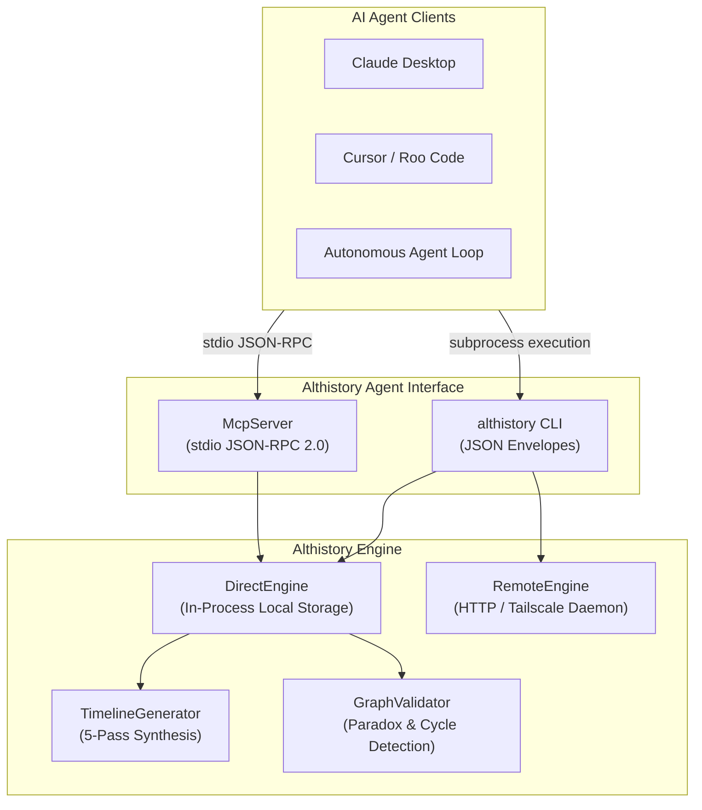

# Althistory Agent Integration & Model Context Protocol (MCP) Guide

This guide explains how AI agents (including Anthropic Claude Desktop, Google Antigravity, Cursor, Roo Code, and autonomous LLM pipelines) connect to and interact with the **Althistory** temporal and causal history platform.

---

## 1. Architecture Overview

Althistory provides an **Agent-First Interface** designed specifically for LLMs to write histories (real, alternate, or of invented worlds with their own calendars) by hand or whole-cloth, ingest historical sources, query causal reasoning paths, and validate timeline consistency.



### Protocol Standards
- **Transport:** Standard input/output (`stdio`) JSON-RPC 2.0.
- **Protocol Version:** MCP `2024-11-05`.
- **Capabilities:** `tools` and `prompts`.
- **Output Purity:** All operational diagnostics, log messages, and debug traces are strictly directed to `stderr`. `stdout` carries exclusively clean JSON-RPC protocol frames or machine-readable JSON envelopes.
- **Execution Modes:**
  - **Direct Mode (`--direct`):** In-process execution using local JSON storage (`timeline/data`), requiring no external daemon or network sockets.
  - **Remote Mode (`--url <daemon-url>`):** Connects to a running Althistory server (local, LAN, or Tailscale node).

---

## 2. MCP Client Configuration

`npm link` in the clone puts `althistory` on your PATH. If your client cannot
find it (Claude Desktop on macOS starts with a minimal PATH), give the full
path to `bin/althistory` in the clone instead; it runs through `npx`, so
`node` must be on the client's PATH.

When the althistory app is running on `127.0.0.1:3000`, the server works
through it, so what an agent writes appears in the app as it goes; otherwise
it works on the local files (`timeline/data`, the same store the app reads).
`althistory_generate_timeline` and `althistory_branch_timeline` run only
in-process, so they need the app stopped; every other tool works either way.
Do not add `--direct` while the app is running: two processes would then
write the same files. Working through the app, the server uses
`ALTHISTORY_API_KEY` if its `env` sets one (give an agent a scoped key that
way), and otherwise the app's own admin key, which `start-local.sh` writes to
`timeline/.env.local`. For another server, also pass `--url`.

To let the server draft with a model, give **the server** a key: add
`ANTHROPIC_API_KEY` (or `OPENAI_API_KEY`) to its `env`. The agent's own model
does not count. Without one, generation returns a template marked
`"source": "template"`.

### A. Claude Desktop / Cursor / Roo Code / Cline
`claude_desktop_config.json` (`~/.config/Claude/` on Linux,
`~/Library/Application Support/Claude/` on macOS), `.cursor/mcp.json`, or your
extension's settings:

```json
{
  "mcpServers": {
    "althistory": {
      "command": "althistory",
      "args": ["mcp"],
      "env": { "ANTHROPIC_API_KEY": "<your key>" }
    }
  }
}
```

The `env` line is only for drafting with a model; leave it out otherwise.

### B. Claude Code

```bash
claude mcp add --scope user althistory -- althistory mcp
```

`--scope user` makes the tools available in every project; without it they
exist only in the directory you ran it in. Claude Code lists the prompts as
`/althistory:worldbuild`, `/althistory:alternate_history` and
`/althistory:grow_history` (typing `/mcp__althistory__worldbuild` works too).
It passes a slash command's words to the prompt's arguments in order, split
on whitespace, so run the prompt on its own (or with the one-word arguments:
`/althistory:worldbuild AR 1000`) and describe the world in your next message.

---

## 3. Three ways to work

The server offers one prompt for each way of working (MCP `prompts/list`). A
client shows them to its user (Claude Code: `/althistory:worldbuild`). Every
argument is optional: the prompt tells the agent to ask for what is missing.
Without MCP, `althistory prompt <name> key=value… --plain` prints the same
text for any agent that can run a command.

| Prompt | Arguments, in order | For |
| --- | --- | --- |
| `worldbuild` | `eraLabel`, `epochYear`, `world` | An invented world with no real history under it: calendar, ages, events, causes, checked as it goes. |
| `alternate_history` | `premise`, `divergencePoint` | Real history turned at one moment: a draft, grounded in what really happened before the turn, then branched. |
| `grow_history` | `graphId` | A graph you already have: read it, extend one thread, validate, branch. Without an id the agent lists the graphs and asks. |

### Inventing a world

An invented world has no real dates, but every timestamp is still an ISO 8601
instant, because sorting, validation and the causal-order checks all read
them. A **world calendar** on the graph relabels the year (and, if you like, the month) when a date is shown:

```json
{ "epochYear": 1000, "eraLabel": "AR", "name": "the Reckoning of the Rising" }
```

`epochYear` is the stored year that is the world's year 1, so the world's year
N is stored as year N + epochYear − 1: with the calendar above, 312 AR is
stored as 1311. The app, the Markdown export and `althistory_export_context`
show "Mar 4, 312 AR"; the export also gives the stored date and the offset, so
an agent writing new events knows what to send. Without `eraLabel` a year reads
"Year 312". Years before the epoch count back ("1 before AR"). Choose an epoch
of 1000 or later: some date libraries read years below 100 as 19xx.

`monthNames`, twelve distinct names, January's first, names the world's
months: with Vael's `["Lowtide", "Greywater", "Thaw", …]` March 4 shows as
"Thaw 4, 312 AR". The months keep their stored order and lengths, and the
days their numbers; a world with thirteen months, or months of other lengths,
cannot be written, because every date is a Gregorian one underneath. A month
name cannot contain a comma, a `|`, brackets, a double quote, or a tab, line
break or other control character. An era label or calendar name may contain a
comma, but not a `|` or a control character. Without `monthNames`
the months are shown as stored ("Mar").

Setting a calendar replaces the whole calendar. To add month names to one
you have, send `epochYear`, `eraLabel` and `calendarName` again with them.

The calendar is kept when the graph is branched or copied, travels in the
export document's `metadata.calendar`, and comes back on import.

A session that builds a world by hand:

1. `althistory_create_graph` with `epochYear` (and `eraLabel`, `calendarName`, `monthNames`).
2. `althistory_create_arc` for each age; `parentArcId` nests a reign inside an age.
3. `althistory_create_event` for each event, with `arcId` to place it.
4. `althistory_link_events` from each cause to its effect. A cause dated after
   its effect is refused, and the refusal is usually a question about the
   history rather than a typo.
5. `althistory_validate_graph`, then `althistory_export_context` to read it back.
6. `althistory_branch_timeline` at an event, to explore another course. A branch
   of a world stays in that world and its calendar.

`althistory_generate_timeline` with `world` drafts a skeleton instead: a model
writes it when the server has `ANTHROPIC_API_KEY` or `OPENAI_API_KEY`, told
that the world is not Earth and how its years are stored; without a key it is a
template of generic ages to rewrite. The result's `source` says which.

Give `reasoning` on every `althistory_link_events` call: without it the link
records "Observed historical causality", which reads oddly in a world nobody
observed. Ingesting prose about a world (`althistory_ingest_text`
into a graph with a calendar) tells the model the calendar too; the offline
pattern reader cannot read invented years, so give it ISO dates or use a model.

---

## 4. Available MCP Tools Reference

The server exposes 14 tools. `althistory schema --mcp` prints their JSON
schemas. A required argument that is missing is refused by name. Every
timestamp is an ISO 8601 stored date (see the calendar above).

### Reading

#### `althistory_list_graphs`
List the graphs, with their calendars. No parameters.

#### `althistory_export_context`
Read a whole graph back.
- `graphId` *(required)*
- `format`: `"markdown"` (default: arcs, events with their arc and what they lead to, causal links with reasoning, dated in the world's calendar when there is one) | `"json"` (the [export document](export-format.md)) | `"dot"`.

#### `althistory_query_causal_path`
Every causal path from one event to another.
- `graphId`, `fromEventId`, `toEventId` *(all required)*

### Writing by hand

#### `althistory_create_graph`
Create an empty graph to write into.
- `name` *(required)*, `description`
- `epochYear`, `eraLabel`, `calendarName`, `monthNames`: an invented world's calendar. A label, name or month names need `epochYear`. `monthNames` is a list of twelve.

#### `althistory_set_calendar`
Give a graph a world calendar, change it, or remove it.
- `graphId` *(required)*
- `epochYear`, `eraLabel`, `calendarName`, `monthNames`; or `clear` set to `true` to remove it (not both). The fields given replace the whole calendar, so a field left out is removed.

#### `althistory_create_arc`
An age, era, reign or campaign that holds events.
- `graphId`, `name`, `startTime`, `endTime` *(required)*
- `description`, `parentArcId` (the arc it sits inside; it is placed one level below it).

#### `althistory_create_event`
- `graphId`, `description`, `timestamp` *(required)*
- `actor`, `target`, `arcId` (puts the event in that arc; if that fails, the error names the event that was created).

#### `althistory_assign_to_arc`
Put an existing event inside an arc.
- `graphId`, `eventId`, `arcId` *(required)*

#### `althistory_link_events`
Record that one event caused another.
- `graphId`, `causeId`, `effectId` *(required)*
- `type`: `"direct"` (default) | `"indirect"` | `"contributory"`
- `weight`: 0 to 1 (default 1)
- `reasoning`: why, in a sentence.

### Generating

#### `althistory_generate_timeline`
Draft a new graph whole-cloth. Give **either** `premise` and `divergencePoint`
(an alternate history) **or** `world` (an invented world), not both.
- `premise`, `divergencePoint`: the what-if, and where real history turns.
- `world`: the world in a few sentences. The graph gets a calendar: `epochYear` defaults to the start date's year, or 1000, so `eraLabel`, `calendarName` and `monthNames` can be given without it. A calendar on an alternate history is refused.
- `startDate`, `endDate`: ISO 8601 (a date-time without a zone is read as UTC). An alternate history starts in the first year from 1000 to 2099 named in the premise or the divergence point (1914 if there is none, so give `startDate` for earlier history) and runs 15 years; a world starts at `startDate`, or its epoch, and runs 300 years, never past 9999.
- `eventCount` (default 8), `style`: `"academic"` | `"narrative"` | `"concise"`, `dryRun`.
- The result's `source` is `"model"`, or `"template"` when there was no model key or the model's answer was unusable: a generic skeleton to rewrite, not a history.

#### `althistory_branch_timeline`
Branch a graph at one of its events and draft a different course from there. Like generation, it drafts with a model only when the server has a key, and its result's `source` says which.
- `sourceGraphId`, `divergeAtEventId`, `counterfactualPrompt`, `branchName` *(required)*
- `eventCount` (default 6), `dryRun`.

#### `althistory_simulate_timeline`
Evolve a graph forward from an event with a mechanical model of the pressures between its actors. It never calls a model: its events are terse and often repetitive, which makes them prompts for what to write rather than finished history.
- `graphId` *(required)*
- `steps` (1–10, default 3), `timeAdvanceMonths` (default 12), `anchorEventId` (default: the latest event)
- `domain`: `"political"` | `"military"` | `"economic"` | `"scientific"` | `"social"` | `"environmental"`
- `aggressiveness` (0–1, default 0.5), `seedContext`, `dryRun`.

#### `althistory_ingest_text`
Extract events, arcs and causal links from prose.
- `text` *(required)*, `graphId` (a new graph when omitted)
- `mode`: `"pattern"` | `"llm"` | `"hybrid"` (default)
- `groupArcs`, `inferCauses` (default true), `dryRun`.

### Checking

#### `althistory_validate_graph`
Inverted chronology, causes after their effects, arcs that do not contain their events, cycles.
- `graphId` *(required)*, `strict` (warnings fail too), `autoRepair` (clamp arc bounds, prune cycle edges).

---

## 5. Tailscale & Remote Network Access

When running the Althistory daemon across a Tailnet:
1. Start the server with Tailscale enabled:
   ```bash
   ./start-local.sh --tailscale
   # or
   npm run dev:tailscale
   ```
2. The server binds to `0.0.0.0` and prints the Tailscale access coordinates (e.g. `http://100.x.y.z:3000`, where `100.x.y.z` is the machine's Tailscale IP).
   Local mode does not require an API key by default (`API_AUTH_REQUIRED` is `false`), so every device on the tailnet can read and change the events, arcs and relationships in your graphs. Set `API_AUTH_REQUIRED=true` in `timeline/.env.local` if that is not what you want.
3. Remote agents connect via CLI:
   ```bash
   althistory --url http://100.x.y.z:3000 --api-key <your-key> graph list
   ```
4. Remote web browsers on your Tailnet access the interactive D3/Cytoscape visualizer at `http://100.x.y.z:5173`.
