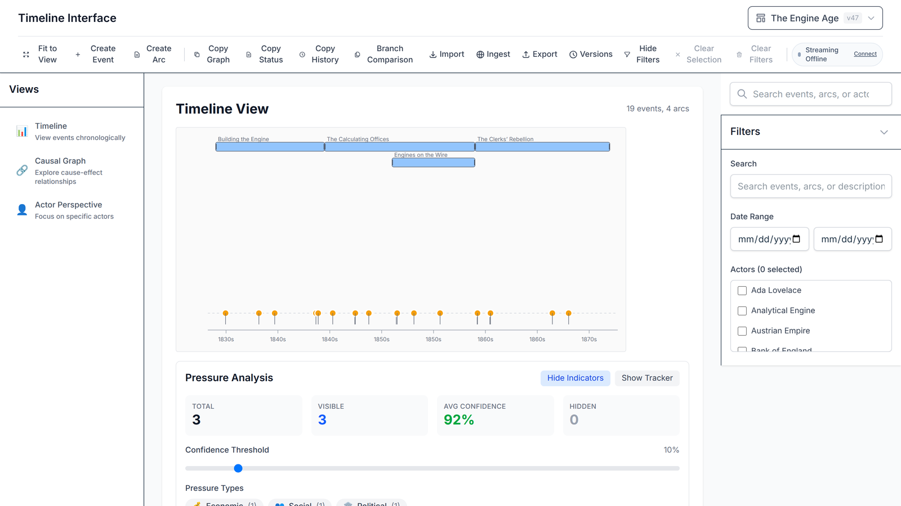
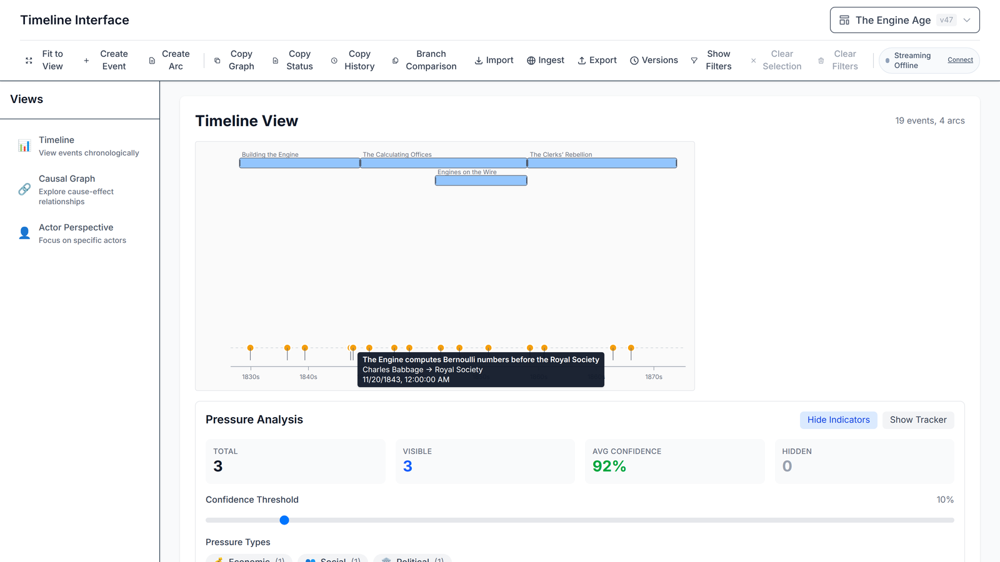
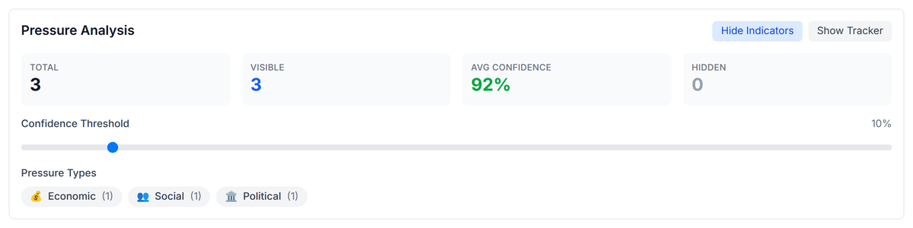
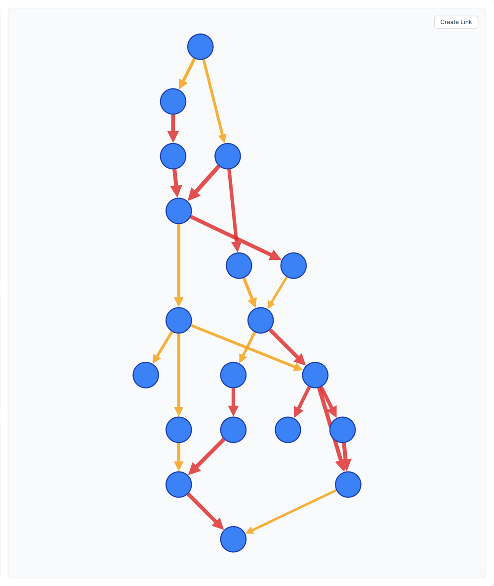
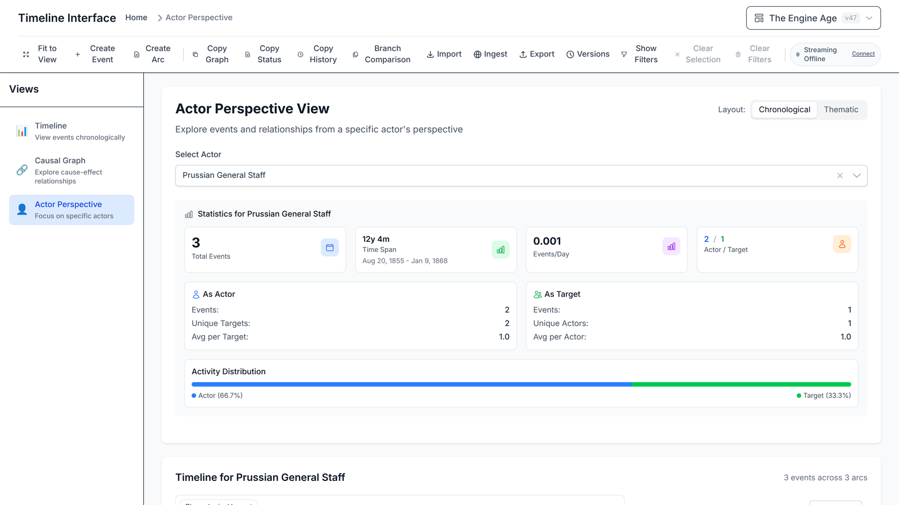
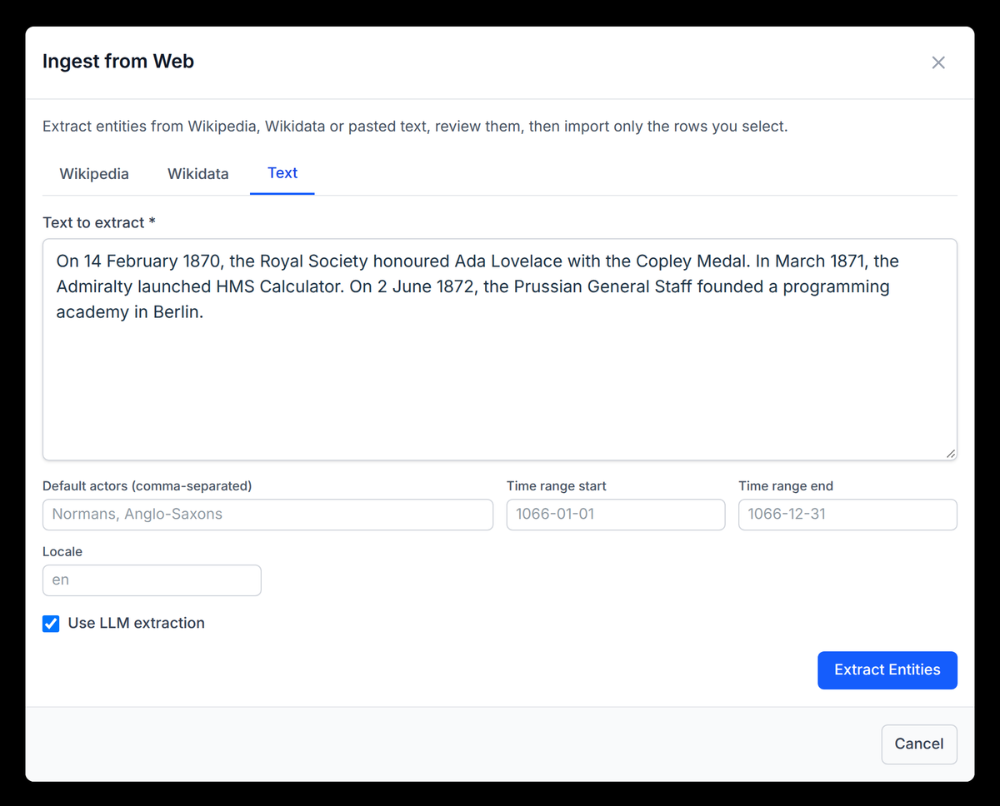
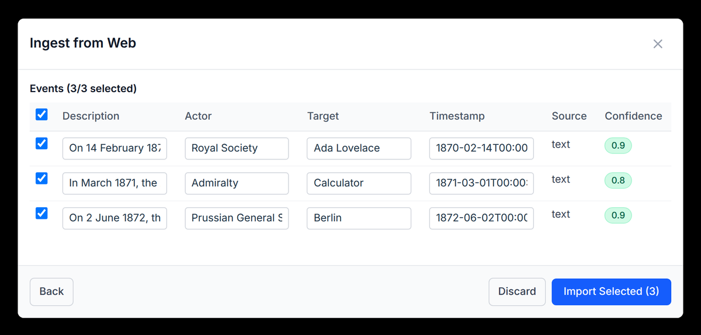
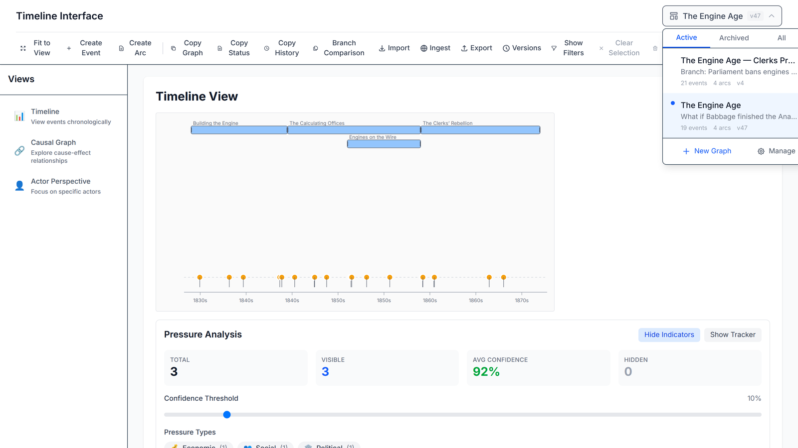

# A tour of althistory

This is the illustrated version of the
[one-minute walkthrough video](media/walkthrough.mp4). It follows a demo
graph, **The Engine Age**, which asks what happens if Charles Babbage finishes
the Analytical Engine in 1843 and Victorian Britain gets programmable
computing a century early.

To follow along with your own copy, run `./start-local.sh` from the
repository root and open <http://localhost:5173>.

> Every picture here is captured from the running app by `media/`, so it shows
> the interface as it is now. To refresh them after a UI change, see
> [Screenshots and video](../README.md#screenshots-and-video).

## 1. The workspace



A graph is one history: its events, the arcs that group them, and the causal
links between them. The **graph selector** in the top right switches between
graphs. The left-hand **Views** switch between the timeline, causal graph and
actor perspective. The **toolbar** holds everything that changes the graph:
creating events and arcs, copying, import, ingestion, export and versions. The
**filter panel** on the right narrows every view by text, date range, actor
or confidence; *Hide Filters* gives the view the full width.

## 2. The timeline



**Arcs** are periods of the history: *Building the Engine*, *The Calculating
Offices*, *The Clerks' Rebellion*. Arcs nest, so *Engines on the Wire* is a
sub-period of *The Calculating Offices* and sits on the row below. Each
**event** is a mark on the axis. Hover one to see what happened, who did it
(the *actor*), to whom (the *target*), and when.

## 3. Inferred pressures



Under the timeline, althistory looks for clusters of related events and infers
the **pressures** behind them. In the demo, the Bank of England following
Lloyd's onto the engines reads as economic pressure, the clerks' protests as
social pressure, and Parliament's debate and Act as political pressure. The
confidence threshold hides the weaker inferences.

## 4. The causal graph



**Causal Graph** shows the same events as a network. Every arrow is a
cause-and-effect link with a type (direct, indirect or contributory) and a
weight, drawn as its thickness. The layout panel rearranges the graph; for a
history, *Directed Graph* reads top to bottom from causes to effects. *Create
Link* adds a relationship by hand.

## 5. Actor perspective



**Actor Perspective** follows one actor through the history. Pick an actor to
see how often they act and how often they are acted upon, and over what span
of time.

## 6. Bringing history in



**Ingest** extracts events from a Wikipedia article, a Wikidata query, or
pasted text. Without a language model configured, a deterministic pattern
reader does the extraction. With one configured, the model reads the text as
well; [`ingestion.md`](ingestion.md) describes the modes and what they cost.



Nothing is written straight away. The extraction lands in a **review table**:
correct an actor, fix a date, untick a row you do not want, then
*Import Selected*.

## 7. Graphs and branches



You can keep as many graphs as you like. **Branching** copies a graph so you
can explore a counterfactual, here *Clerks Prevail*, in which Parliament
bans the engines outright, without touching the original.
[`branch-merge-resolver.md`](branch-merge-resolver.md) covers combining two
graphs again.

## 8. The same, from a script

Everything in the interface is also a CLI command and an MCP tool, so agents
and scripts can build histories too:

```bash
./bin/althistory graph create "The Engine Age"
./bin/althistory ingest url "https://en.wikipedia.org/wiki/Analytical_engine" -g <graphId>
./bin/althistory export <graphId> --format markdown
./bin/althistory mcp          # stdio MCP server for Claude, Cursor and others
```

See the [CLI reference](../timeline/src/cli/README.md) and the
[MCP agent guide](mcp-agent-guide.md).
