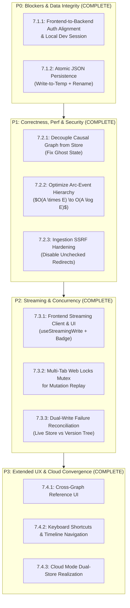

# Principal Engineer Remediation & Implementation Plan

**Status:** Completed (Phase 7 Complete)  
**Baseline:** `phase5-round2` @ `8117f31` (Frontend: 1585 passed / 1 skipped; Backend: 1549 passed / 1 skipped; E2E: 6 passed)  
**Author:** Principal Engineer Review  
**Related Documents:**
- [Gap Remediation Plan](impl/gap-remediation/README.md)
- [Graph Scoped Isolation Design](impl/gap-remediation/02-graph-scoped-isolation-design.md)
- [Phase 6 Results](impl/gap-remediation/phase6-results.md)
- [Independent Review Practice](impl/gap-remediation/REVIEW.md)

---

## Executive Summary

Phase 6.4 delivered the end-to-end Playwright and visual regression test harness. However, an architectural review of the repository revealed several critical disconnects between the backend and frontend that were masked because unit tests and E2E specs mock and intercept the network boundary. Additionally, data integrity risks (non-atomic file writes, two-store split-brain) and severe UI thread bottlenecks ($O(A \times E)$ timestamp parsing) remain unaddressed.

This plan outlines concrete, testable implementation tasks organized by priority to bring the system to production-grade reliability.



---

## Phase 7.1: P0 Blockers & Data Integrity

### 7.1.1: Frontend-to-Backend Authentication Alignment & Local Dev Session
- **Priority:** P0 (Blocker)
- **Target Files:**
  - [`timeline/src/api/middleware.ts`](timeline/src/api/middleware.ts#L430-L488)
  - [`timeline/src/api/routes/events.ts`](timeline/src/api/routes/events.ts)
  - [`timeline/src/api/routes/arcs.ts`](timeline/src/api/routes/arcs.ts)
  - [`timeline/src/api/routes/causal.ts`](timeline/src/api/routes/causal.ts)
  - [`frontend/src/services/api.ts`](frontend/src/services/api.ts#L141-L151)
- **Problem Statement:**
  1. Backend protected routes (`/api/graphs`, `/api/export`, `/api/ingest`, `/api/stream/token`, `/api/keys`) enforce `authenticate` and `requireAuth`, which look strictly for `req.get('X-API-Key')`.
  2. The frontend [`api.ts`](frontend/src/services/api.ts#L146) only sets `Authorization: Bearer <auth_token>`, never sends `X-API-Key`, and has no default key bootstrap.
  3. When running via [`start-local.sh`](start-local.sh), the frontend immediately calls `GET /api/graphs`, receives `401 Unauthorized`, and tries to redirect to a non-existent `/login` route.
  4. Core entity routes (`events.ts`, `arcs.ts`, `causal.ts`) have zero authentication middleware, allowing unauthenticated mutation across graphs.
- **Implementation Tasks:**
  - [x] **Dual-Header Support in Backend Middleware**: Update `authenticate` in `middleware.ts` to inspect both `X-API-Key` and `Authorization: Bearer <key>`.
  - [x] **Local Execution Mode Bypass / Default Dev Key**: When `LOCAL_EXECUTION_ENABLED=true` (or when `LOCAL_DEV_BYPASS=true`), provide an automatic developer identity with full permissions if no key header is provided, or bootstrap an initial dev API key on startup.
  - [x] **Uniform Auth Protection on Entity Routes**: Mount `authenticate` and `requireAuth` on `events.ts`, `arcs.ts`, and `causal.ts` so all routes adhere to consistent security boundaries.
  - [x] **Frontend Interceptor Updates**: Update Axios request interceptor in `frontend/src/services/api.ts` to sync `X-API-Key` from local storage / environment configuration.
  - [x] **Real E2E Non-Intercepted Integration Test**: Add an integration test that boots the real Express server and verifies the real frontend can load graphs without 401s.
- **Verification:**
  1. Unit test in `timeline/src/api/middleware.test.ts` verifying `Authorization: Bearer <key>` succeeds.
  2. Local development run `./start-local.sh` allows loading the app and fetching `/api/graphs` without 401 redirect errors.

---

### 7.1.2: Atomic JSON Persistence in `LocalGraphStore`
- **Priority:** P0 (Data Loss Risk)
- **Target Files:**
  - [`timeline/src/utils/LocalGraphStore.ts`](timeline/src/utils/LocalGraphStore.ts#L1344-L1367)
  - [`timeline/src/utils/GraphContextStore.ts`](timeline/src/utils/GraphContextStore.ts#L390-L432)
- **Problem Statement:**
  In `LocalGraphStore.save()`, the graph state is saved via direct `fs.writeFile`:
  ```typescript
  await fs.writeFile(this.dataFile, JSON.stringify(serializableData, null, 2));
  ```
  An abrupt termination (SIGKILL, OOM, power cut) leaves a truncated file. On subsequent startup, `inspectPersistedFile()` throws `DataCorruptionError`, permanently bricking that graph's live store.
- **Implementation Tasks:**
  - [x] **Write-to-Temp-and-Rename Pattern**:
    Write serialized JSON to a unique temporary file in the same directory:
    ```typescript
    const tempFile = `${this.dataFile}.${Date.now()}.${Math.random().toString(36).slice(2)}.tmp`;
    await fs.writeFile(tempFile, JSON.stringify(serializableData, null, 2), 'utf8');
    await fs.rename(tempFile, this.dataFile);
    ```
  - [x] **Cleanup of Stale Temp Files**: Add cleanup of orphaned `.tmp` files during `load()` or store initialization.
  - [x] **Simulated Interruption Test**: Write a unit test simulating a failed write and verifying that the original file remains intact.
- **Verification:**
  Unit tests in `LocalGraphStore.test.ts` verifying atomic replacement and resilience to write errors.

---

## Phase 7.2: P1 Correctness, Performance & Security

### 7.2.1: Decouple Causal Graph View from Global Zustand Sync (Ghost State Elimination)
- **Priority:** P1 (UI Correctness)
- **Target Files:**
  - [`frontend/src/components/views/CausalGraphView.tsx`](frontend/src/components/views/CausalGraphView.tsx#L40-L72)
  - [`frontend/src/components/causal-graph/CausalGraphComponent.tsx`](frontend/src/components/causal-graph/CausalGraphComponent.tsx#L125-L132)
  - [`frontend/src/hooks/useGraphs.ts`](frontend/src/hooks/useGraphs.ts#L209-L222)
- **Problem Statement:**
  `CausalGraphView` fetches data with React Query, but copies it to Zustand `globalStore.events` via `useEffect`. If the active graph has 0 events, `fetchedEvents.length > 0` is false, so `setEvents` is never called, leaving the previous graph's events rendered. Additionally, switching graphs leaves stale selections in `globalStore.selectedEvents`.
- **Implementation Tasks:**
  - [x] **Prop-Driven Architecture for Causal Graph**:
    Refactor `CausalGraphComponent` to accept `events: Event[]` and `relationships: CausalRelationship[]` directly as props (matching `Timeline.tsx` and `ActorTimeline.tsx`).
  - [x] **Remove Zustand Side-Effect Sync**: Remove `setEvents` and `setCausalRelationships` effects from `CausalGraphView.tsx`.
  - [x] **Graph Switch Selection Reset**: In `useSwitchGraph.onSuccess` (or `globalStore`), reset `selectedEvents` and `selectedArcs` to empty arrays when changing graphs.
  - [x] **Empty Graph Rendering Test**: Add a test verifying that switching from a populated graph to an empty graph renders an empty graph canvas, with no residual nodes.
- **Verification:**
  `CausalGraphView.test.tsx` verifying immediate clearance of graph canvas when switching to an empty graph.

---

### 7.2.2: Optimize Arc-Event Hierarchy Calculation ($O(A \times E) \to O(A \log E)$)
- **Priority:** P1 (Performance)
- **Target Files:**
  - [`frontend/src/components/timeline/arcHierarchyUtils.ts`](frontend/src/components/timeline/arcHierarchyUtils.ts#L120-L165)
  - [`frontend/src/components/timeline/Timeline.tsx`](frontend/src/components/timeline/Timeline.tsx#L231-L245)
- **Problem Statement:**
  `processArcsWithUIState` scans every event for every arc and instantiates `new Date(...)` twice per pair on every arc click, selection, or expand/collapse. For 300 arcs and 10,000 events, this executes 3,000,000 `new Date()` allocations, blocking the main thread for ~1.0s.
- **Implementation Tasks:**
  - [x] **Pre-Parse Timestamps Once**:
    Normalize event and arc timestamps to epoch milliseconds (`timestampMs`, `startMs`, `endMs`) once when fetched or memoized.
  - [x] **Index Events by Timestamp**:
    Sort pre-parsed events by timestamp once ($O(E \log E)$).
  - [x] **Binary Search Containment**:
    For each arc, use binary search to locate the index range `[startIndex, endIndex]` of events falling within `[arc.startMs, arc.endMs]` in $O(\log E)$ time:
    ```typescript
    // Overall complexity drops from O(A * E) to O(E log E + A log E)
    ```
  - [x] **Index Parent/Child Arcs**:
    Build an `id -> Arc` map and `parent_arc_id -> Arc[]` map to replace $O(A^2)$ linear child/parent scans with $O(A)$ lookups.
  - [x] **Performance Regression Test**:
    Add a benchmark test asserting that processing 300 arcs with 10,000 events executes in `< 25ms` (down from ~1,000ms).
- **Verification:**
  Vitest performance test in `arcHierarchyUtils.test.ts`.

---

### 7.2.3: Ingestion SSRF Hardening (Unchecked Redirect Elimination)
- **Priority:** P1 (Security)
- **Target Files:**
  - [`timeline/src/services/ingestion/http.ts`](timeline/src/services/ingestion/http.ts#L98-L142)
- **Problem Statement:**
  `FetchHttpClient.assertAllowedUrl()` verifies that request URLs point to `*.wikipedia.org` or `query.wikidata.org`. However, `fetch` runs with default `redirect: 'follow'`. An open redirect on an allowlisted host could redirect the request to internal infrastructure or cloud instance metadata (`http://169.254.169.254/latest/meta-data/`).
- **Implementation Tasks:**
  - [x] **Manual Redirect Handling or Refusal**:
    Configure `fetch` with `redirect: 'manual'` (or a maximum redirect limit with explicit re-validation).
  - [x] **Redirect Target Verification**:
    If following redirects, extract the `Location` header and pass the target URL through `assertAllowedUrl()` before issuing the redirect request.
  - [x] **Redirect Attack Test**:
    Add test in `http.test.ts` verifying that a 302 redirect from an allowlisted host to a disallowed host (e.g. `http://169.254.169.254`) is refused.
- **Verification:**
  `npm test -- src/services/ingestion/http.test.ts` passing with redirect attack assertions.

---

## Phase 7.3: P2 Streaming, Concurrency & Dual-Store Resilience

### 7.3.1: Frontend Streaming Client & Real-Time Indicator (Phase 5.6 & 5.7)
- **Priority:** P2 (Feature Completeness)
- **Target Files:**
  - `frontend/src/hooks/useStreamingWrite.ts` (new)
  - `frontend/src/components/streaming/StreamingStatusBadge.tsx` (new)
  - [`frontend/src/components/views/ViewToolbar.tsx`](frontend/src/components/views/ViewToolbar.tsx)
  - [`frontend/src/services/api.ts`](frontend/src/services/api.ts)
- **Implementation Tasks:**
  - [x] **Add Stream Token API Client**: Add `apiClient.stream.getToken(graphId)` calling `POST /api/stream/token`.
  - [x] **Build `useStreamingWrite` Hook**:
    - Manage WebSocket lifecycle (`connect`, `reconnect`, `disconnect`).
    - Implement outgoing queue with `requestId` and in-flight bounding (max 4).
    - Handle `ack`, `warning`, `error`, and `auth_result` server messages.
    - Token auto-refresh on session expiration.
  - [x] **Real-time Indicator Component**:
    - Mount `StreamingStatusBadge` in `ViewToolbar` displaying connection state (Connected, Streaming, Disconnected, Error).
  - [x] **Hook and Component Tests**:
    Write unit tests with a mock WebSocket server verifying send, ack handling, backpressure refusal, and reconnection.
- **Verification:**
  Vitest hook tests in `frontend/src/hooks/useStreamingWrite.test.ts`.

---

### 7.3.2: Multi-Tab Web Locks Mutex for Offline Mutation Replay
- **Priority:** P2 (Concurrency & Data Integrity)
- **Target Files:**
  - [`frontend/src/offline/mutationReplay.ts`](frontend/src/offline/mutationReplay.ts#L100-L150)
  - [`frontend/src/offline/offlineSync.ts`](frontend/src/offline/offlineSync.ts)
- **Problem Statement:**
  `mutationQueue.ts` stores pending mutations in `localStorage` without a cross-tab mutex. If a user opens multiple tabs and reconnects, both tabs trigger replay simultaneously, duplicating entity creation on the server.
- **Implementation Tasks:**
  - [x] **Web Locks API Integration**:
    Wrap the replay execution in `navigator.locks.request`:
    ```typescript
    if (typeof navigator !== 'undefined' && 'locks' in navigator) {
      await navigator.locks.request('althistory_mutation_replay_lock', { ifAvailable: true }, async (lock) => {
        if (!lock) return; // Another tab is already replaying
        await performReplay();
      });
    } else {
      await performReplay();
    }
    ```
  - [x] **Idempotency Keys on Creation**:
    Include `mutation.id` in the request header (`X-Idempotency-Key: <id>`) or payload so that even if a duplicate request arrives, the server can deduplicate.
  - [x] **Multi-Tab Replay Test**:
    Add unit test simulating concurrent replay calls and verifying only one sender fires.
- **Verification:**
  Vitest test in `frontend/src/offline/mutationReplay.test.ts`.

---

### 7.3.3: Two-Store Dual-Write Failure Reconciliation
- **Priority:** P2 (Data Integrity)
- **Target Files:**
  - [`timeline/src/services/GraphWriteVersioningService.ts`](timeline/src/services/GraphWriteVersioningService.ts)
  - [`timeline/src/api/routes/events.ts`](timeline/src/api/routes/events.ts#L38-L45)
  - [`timeline/src/websocket/StreamHandler.ts`](timeline/src/websocket/StreamHandler.ts#L1080-L1100)
- **Problem Statement:**
  Writes sequentially mutate `eventRepository` (live store) and `GraphWriteVersioningService` (content-addressed tree). If version commit fails:
  - HTTP routes throw 500, leaving an un-versioned ghost entity in the live store.
  - WebSocket routes swallow the error, returning `success: true`.
- **Implementation Tasks:**
  - [x] **Compensating Rollback on HTTP Write Failure**:
    In `events.ts`, `arcs.ts`, and `causal.ts`, wrap version commit in `try...catch`. If `recordEvent` fails, issue a compensating delete to the live repository (`await repository.delete(created.id)`), then rethrow the error.
  - [x] **Align WebSocket Error Semantics**:
    If version recording fails in `StreamHandler`, decide on unified semantics (either roll back live entity or guarantee background reconciliation via an event queue).
- **Verification:**
  Integration test in `events.test.ts` verifying that if versioning throws, the live store does not retain the orphaned event.

---

## Phase 7.4: P3 Extended UX & Cloud Convergence

### 7.4.1: Cross-Graph Reference UI (Phase 5.8)
- **Target Files:**
  - `frontend/src/components/modals/CausalRelationshipModal.tsx`
  - `frontend/src/components/causal-graph/CausalGraphComponent.tsx`
- **Tasks:**
  - [x] Add target graph selector in `CausalRelationshipModal` for cross-graph links.
  - [x] Render cross-graph links with distinct styling (e.g. dashed edge with foreign graph indicator pill).
  - [x] Handle missing/broken foreign entity references gracefully via synthesized placeholder nodes.

### 7.4.2: Global Keyboard Navigation & Gestures (Phase 5.5 / Task 14.1)
- **Target Files:**
  - `frontend/src/hooks/useGlobalKeyboardShortcuts.ts` (new)
  - [`frontend/src/components/views/ViewToolbar.tsx`](frontend/src/components/views/ViewToolbar.tsx)
  - [`frontend/src/components/timeline/Timeline.tsx`](frontend/src/components/timeline/Timeline.tsx)
- **Tasks:**
  - [x] Implement global hotkeys: `Ctrl+N` (New Event), `F` (Toggle Filter Panel), `Ctrl+Shift+C` (New Arc).
  - [x] Add arrow key panning (`Left`/`Right`) and zoom keys (`+`/`-`) for Timeline.
  - [x] Add keyboard navigation accessibility tests.

### 7.4.3: Cloud Mode Dual-Store Realization
- **Target Files:**
  - [`timeline/src/container.ts`](timeline/src/container.ts#L340-L370)
  - `timeline/src/services/RateLimitService.ts`
- **Tasks:**
  - [x] When `LOCAL_EXECUTION_ENABLED=false`, bind `graphScopedRepositories` to Neo4j sessions rather than `LocalGraphStore`.
  - [x] Implement Redis backing for rate limits and streaming tokens in distributed deployments.

---

## Execution Order & Quality Gates

```
┌─────────────────────────────────────────────────────────────┐
│ 1. Phase 7.1 (P0): Fix Auth Wall + Atomic Save (Local Dev)  │
│    Gate: ./start-local.sh loads UI without 401s; tests pass │
└──────────────────────────────┬──────────────────────────────┘
                               │
┌──────────────────────────────▼──────────────────────────────┐
│ 2. Phase 7.2 (P1): Decouple Causal Graph + O(A log E) Perf  │
│    Gate: Sub-25ms arc hierarchy; zero ghost state on empty  │
└──────────────────────────────┬──────────────────────────────┘
                               │
┌──────────────────────────────▼──────────────────────────────┐
│ 3. Phase 7.3 (P2): WS Streaming Client + Web Locks Replay   │
│    Gate: Stream write hook tested; multi-tab deduplication  │
└──────────────────────────────┬──────────────────────────────┘
                               │
┌──────────────────────────────▼──────────────────────────────┐
│ 4. Phase 7.4 (P3): Shortcuts, Cross-Graph UI & Cloud Mode   │
│    Gate: Keyboard navigation tested; spec completed         │
└─────────────────────────────────────────────────────────────┘
```

### Mandatory Quality Gates for Every PR/Slice
1. **Typecheck**: `npm run build` in both `timeline/` and `frontend/` exits 0.
2. **Lint**: `npm run lint` exits 0 with 0 errors.
3. **Unit & Integration Tests**: `./run-tests.sh` exits 0 (no skipped/disabled tests added).
4. **End-to-End Tests**: `cd e2e && npx playwright test` exits 0 (all specs green).
5. **No Suppressions**: No `any`, `@ts-ignore`, or `eslint-disable` added to production code.
