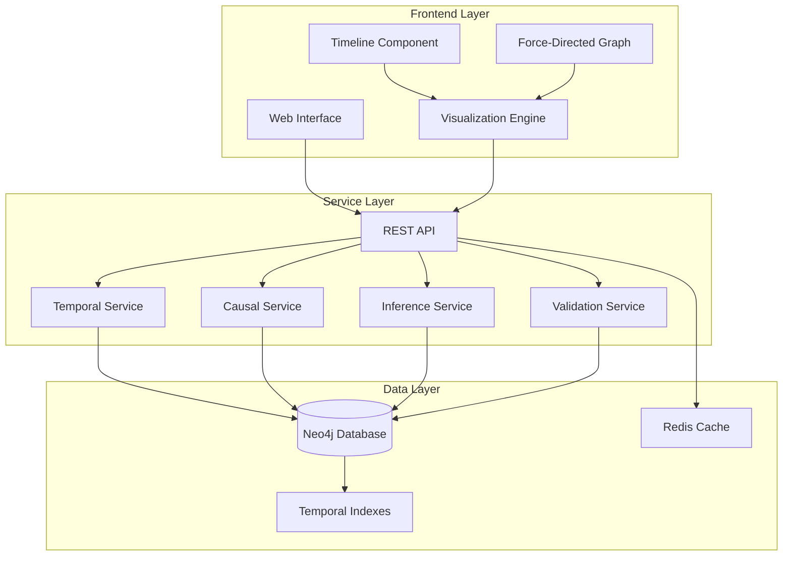

# Design Document

## Overview

The Hierarchical Temporal Graph system implements a sophisticated graph-based data model for capturing and analyzing historical events across multiple temporal scales. The system uses a layered architecture with a graph database backend (Neo4j), a service layer for business logic and temporal constraints, and a visualization frontend supporting both timeline and network views.

The core innovation lies in the hierarchical temporal modeling that allows fine-grained events to be organized into nested phases (arcs) while maintaining explicit causal relationships and supporting inference of underlying historical pressures. This enables researchers to analyze history at multiple scales simultaneously.

## Architecture

### System Architecture



### Technology Stack

- **Database**: Neo4j 5.x for graph storage with native temporal indexing
- **Backend**: Node.js with Express.js for REST API
- **Caching**: Redis for query result caching and session management
- **Frontend**: React with D3.js for visualizations
- **Visualization Libraries**: 
  - D3.js for custom timeline components
  - Cytoscape.js for force-directed causal graphs
  - React-Timeline for hierarchical timeline views

## Components and Interfaces

### Core Domain Models

#### Event Node
```typescript
interface Event {
  id: string;
  description: string;
  actor: string;
  target: string;
  timestamp: Date;
  metadata?: Record<string, any>;
}
```

#### Arc Node (Historical Phase)
```typescript
interface Arc {
  id: string;
  name: string;
  description?: string;
  start_time: Date;
  end_time: Date;
  level: number; // Hierarchy level for nesting
  metadata?: Record<string, any>;
}
```

#### InferredPressure Node
```typescript
interface InferredPressure {
  id: string;
  description: string;
  confidence_score: number; // 0.0 to 1.0
  pressure_type: 'economic' | 'social' | 'environmental' | 'political';
  evidence: string[];
}
```

#### Relationship Types
```typescript
interface CausalRelationship {
  weight: number; // 0.0 to 1.0
  evidence: string;
  confidence: number;
  relationship_type: 'direct' | 'indirect' | 'contributory';
}

interface PartOfRelationship {
  // Events belong to Arcs
  temporal_relevance: number; // How central this event is to the arc
}

interface SubsumesRelationship {
  // Arc hierarchy relationships
  containment_type: 'complete' | 'partial' | 'overlapping';
}

interface DrivenByRelationship {
  // Arcs driven by InferredPressures
  influence_strength: number;
}
```

### Service Layer Components

#### TemporalService
Handles all temporal operations and constraint enforcement:

```typescript
class TemporalService {
  validateEventInArc(event: Event, arc: Arc): boolean;
  validateArcNesting(parentArc: Arc, childArc: Arc): boolean;
  findOverlappingArcs(timeRange: TimeRange): Arc[];
  findEventsInRange(timeRange: TimeRange): Event[];
  preventTemporalParadox(cause: Event, effect: Event): boolean;
}
```

#### CausalService
Manages causal relationships and chain analysis:

```typescript
class CausalService {
  createCausalLink(cause: Event, effect: Event, relationship: CausalRelationship): void;
  findCausalChain(startEvent: Event, maxDepth: number): CausalPath[];
  calculateCausalStrength(path: CausalPath): number;
  detectCausalCycles(): CausalCycle[];
}
```

#### InferenceService
Handles pattern detection and pressure inference:

```typescript
class InferenceService {
  analyzeEventClusters(events: Event[]): InferredPressure[];
  updatePressureConfidence(pressure: InferredPressure, newEvidence: Event[]): void;
  suggestCausalLinks(events: Event[]): CausalSuggestion[];
  runPeriodicInference(): void; // Background process
}
```

#### GraphCopyService
Manages graph duplication and subset operations:

```typescript
class GraphCopyService {
  copyFullGraph(sourceGraphId: string, targetGraphId: string): Promise<CopyResult>;
  copyByTimeRange(sourceGraphId: string, timeRange: TimeRange, targetGraphId: string): Promise<CopyResult>;
  copyByEntityFilter(sourceGraphId: string, filter: EntityFilter, targetGraphId: string): Promise<CopyResult>;
  validateCopyIntegrity(copyResult: CopyResult): IntegrityReport;
}
```

### Visualization Components

#### TimelineVisualization
Interactive timeline with hierarchical arc display:

```typescript
class TimelineVisualization {
  renderTimeline(arcs: Arc[], events: Event[]): void;
  handleZoom(timeRange: TimeRange): void;
  showArcDetails(arc: Arc): void;
  highlightCausalChain(chain: CausalPath): void;
}
```

#### CausalGraphVisualization
Force-directed graph for causal relationship exploration:

```typescript
class CausalGraphVisualization {
  renderCausalGraph(events: Event[], relationships: CausalRelationship[]): void;
  applyForceLayout(): void;
  filterByWeight(minWeight: number): void;
  highlightPath(path: CausalPath): void;
}
```

## Data Models

### Neo4j Schema Design

#### Node Labels and Properties
```cypher
// Event nodes
CREATE CONSTRAINT event_id FOR (e:Event) REQUIRE e.id IS UNIQUE;
CREATE INDEX event_timestamp FOR (e:Event) ON (e.timestamp);
CREATE INDEX event_actor FOR (e:Event) ON (e.actor);

// Arc nodes  
CREATE CONSTRAINT arc_id FOR (a:Arc) REQUIRE a.id IS UNIQUE;
CREATE INDEX arc_timerange FOR (a:Arc) ON (a.start_time, a.end_time);
CREATE INDEX arc_level FOR (a:Arc) ON (a.level);

// InferredPressure nodes
CREATE CONSTRAINT pressure_id FOR (p:InferredPressure) REQUIRE p.id IS UNIQUE;
CREATE INDEX pressure_confidence FOR (p:InferredPressure) ON (p.confidence_score);
```

#### Relationship Constraints
```cypher
// Temporal integrity constraints
CREATE CONSTRAINT temporal_event_arc 
FOR ()-[r:PART_OF]-() 
REQUIRE r.temporal_relevance >= 0.0 AND r.temporal_relevance <= 1.0;

// Causal relationship constraints
CREATE CONSTRAINT causal_weight 
FOR ()-[r:CAUSES]-() 
REQUIRE r.weight >= 0.0 AND r.weight <= 1.0;
```

### Temporal Indexing Strategy

The system uses Neo4j's native temporal functions combined with custom indexing:

```cypher
// Temporal range queries optimized with compound indexes
CREATE INDEX arc_temporal_compound FOR (a:Arc) ON (a.start_time, a.end_time, a.level);

// Event temporal queries with actor filtering
CREATE INDEX event_temporal_actor FOR (e:Event) ON (e.timestamp, e.actor);
```

### Data Integrity Rules

1. **Temporal Containment**: Events must fall within their assigned arc boundaries
2. **Arc Hierarchy**: Child arcs must be completely contained within parent arcs
3. **Causal Ordering**: Causal relationships cannot create temporal paradoxes
4. **Confidence Bounds**: All confidence scores must be between 0.0 and 1.0
5. **Referential Integrity**: Relationships can only exist between valid nodes

## Error Handling

### Temporal Constraint Violations
```typescript
class TemporalConstraintError extends Error {
  constructor(
    public eventId: string,
    public arcId: string,
    public eventTime: Date,
    public arcBounds: { start: Date; end: Date }
  ) {
    super(`Event ${eventId} at ${eventTime} falls outside arc ${arcId} bounds`);
  }
}
```

### Causal Paradox Detection
```typescript
class CausalParadoxError extends Error {
  constructor(
    public causeId: string,
    public effectId: string,
    public causeTime: Date,
    public effectTime: Date
  ) {
    super(`Causal paradox: effect ${effectId} at ${effectTime} precedes cause ${causeId} at ${causeTime}`);
  }
}
```

### Performance Degradation Handling
- Query timeout mechanisms (2-second limit for standard queries)
- Automatic query optimization suggestions
- Graceful degradation with cached results
- Progressive loading for large datasets

## Testing Strategy

### Unit Testing
- **Temporal Logic**: Test all temporal constraint validations
- **Causal Analysis**: Test causal chain detection and cycle prevention
- **Inference Engine**: Test pattern detection algorithms
- **Graph Operations**: Test CRUD operations with integrity constraints

### Integration Testing
- **Database Integration**: Test Neo4j query performance and indexing
- **Service Layer**: Test inter-service communication and data flow
- **API Endpoints**: Test REST API with various data scenarios
- **Visualization**: Test frontend-backend data synchronization

### Performance Testing
- **Load Testing**: Test with datasets up to 100,000 events
- **Query Performance**: Benchmark temporal and causal queries
- **Memory Usage**: Monitor memory consumption during large operations
- **Concurrent Access**: Test multi-user scenarios

### Historical Data Validation
- **Temporal Accuracy**: Validate historical dates and chronological ordering
- **Causal Plausibility**: Test causal relationship validation logic
- **Hierarchy Consistency**: Verify arc nesting maintains logical structure
- **Inference Quality**: Evaluate pressure detection accuracy with known historical patterns

### Copy Operation Testing
- **Full Graph Copy**: Test complete graph duplication with integrity preservation
- **Subset Copy**: Test time-range and entity-filtered copying
- **Referential Integrity**: Verify relationships are properly maintained in copies
- **Performance**: Test copy operations with large datasets