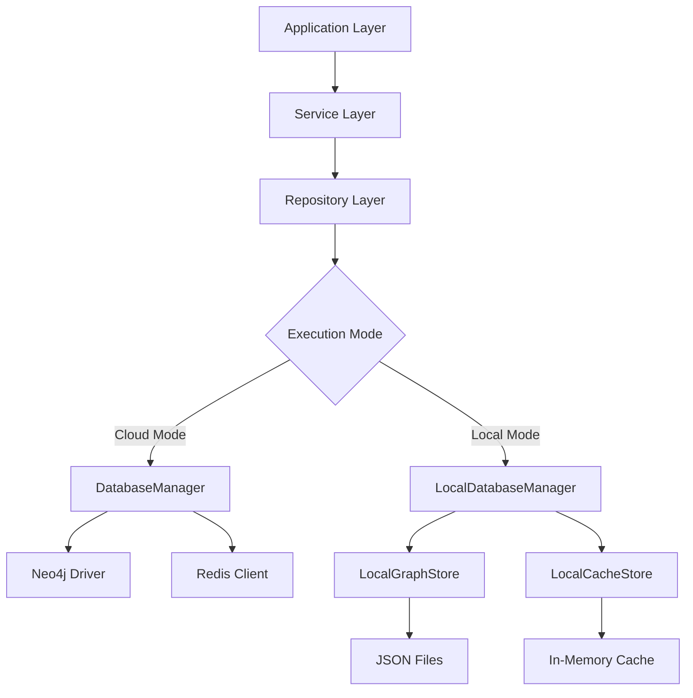

# Local Execution Design Document

## Overview

The local execution feature enables the hierarchical temporal graph system to run entirely on a local machine without external dependencies on Neo4j and Redis. This is achieved by implementing embedded alternatives that provide the same interfaces as the cloud-based services while persisting data locally using file-based storage and in-memory caching.

The design maintains full API compatibility with the existing cloud-based implementation, allowing seamless switching between local and cloud modes through configuration changes.

## Architecture

### High-Level Architecture



### Local Execution Components

1. **LocalDatabaseManager**: Replaces the existing DatabaseManager for local execution
2. **LocalGraphStore**: File-based graph database implementation
3. **LocalCacheStore**: In-memory cache implementation
4. **ConfigurationManager**: Enhanced configuration system supporting local mode
5. **DataPersistence**: File system abstraction for data storage

## Components and Interfaces

### LocalDatabaseManager

The `LocalDatabaseManager` implements the same interface as `DatabaseManager` but uses local storage implementations:

```typescript
interface ILocalDatabaseManager {
  initializeNeo4j(): Promise<void>;
  initializeRedis(): Promise<void>;
  getNeo4jSession(database?: string, options?: SessionOptions): ILocalSession;
  getReadOnlySession(database?: string): ILocalSession;
  executeQuery<T>(query: string, parameters?: Record<string, any>, options?: QueryOptions): Promise<T[]>;
  getRedisClient(): ILocalCacheClient;
  close(): Promise<void>;
  healthCheck(): Promise<HealthStatus>;
}
```

### LocalGraphStore

File-based graph storage that mimics Neo4j operations:

```typescript
interface ILocalGraphStore {
  // Node operations
  createNode(labels: string[], properties: Record<string, any>): Promise<string>;
  getNode(id: string): Promise<Node | null>;
  updateNode(id: string, properties: Record<string, any>): Promise<void>;
  deleteNode(id: string): Promise<void>;
  
  // Relationship operations
  createRelationship(fromId: string, toId: string, type: string, properties?: Record<string, any>): Promise<string>;
  getRelationships(nodeId: string, direction?: 'IN' | 'OUT' | 'BOTH'): Promise<Relationship[]>;
  
  // Query operations
  executeCypher(query: string, parameters: Record<string, any>): Promise<QueryResult>;
  
  // Persistence
  save(): Promise<void>;
  load(): Promise<void>;
}
```

### LocalCacheStore

In-memory cache implementation replacing Redis:

```typescript
interface ILocalCacheStore {
  get(key: string): Promise<string | null>;
  set(key: string, value: string, ttl?: number): Promise<void>;
  del(key: string): Promise<number>;
  exists(key: string): Promise<number>;
  expire(key: string, seconds: number): Promise<number>;
  flushall(): Promise<void>;
  keys(pattern: string): Promise<string[]>;
}
```

### Configuration Enhancement

Extended configuration to support local execution mode:

```typescript
interface LocalExecutionConfig {
  enabled: boolean;
  dataDirectory: string;
  graphFile: string;
  cacheSize: number;
  persistenceInterval: number;
  backupEnabled: boolean;
  backupInterval: number;
}

interface EnhancedAppConfig extends AppConfig {
  localExecution: LocalExecutionConfig;
}
```

## Data Models

### Local Graph Storage Format

Graph data is stored in JSON format with the following structure:

```typescript
interface LocalGraphData {
  nodes: {
    [id: string]: {
      id: string;
      labels: string[];
      properties: Record<string, any>;
      createdAt: string;
      updatedAt: string;
    };
  };
  relationships: {
    [id: string]: {
      id: string;
      type: string;
      startNodeId: string;
      endNodeId: string;
      properties: Record<string, any>;
      createdAt: string;
      updatedAt: string;
    };
  };
  metadata: {
    version: string;
    lastModified: string;
    nodeCount: number;
    relationshipCount: number;
  };
}
```

### Cache Storage Format

Cache entries are stored in memory with TTL support:

```typescript
interface CacheEntry {
  value: string;
  expiresAt: number | null;
  createdAt: number;
}

interface LocalCacheData {
  entries: Map<string, CacheEntry>;
  stats: {
    hits: number;
    misses: number;
    sets: number;
    deletes: number;
  };
}
```

## Error Handling

### Local Storage Errors

1. **File System Errors**: Handle disk space, permissions, and I/O errors
2. **Data Corruption**: Detect and recover from corrupted data files
3. **Concurrency Issues**: Prevent data corruption from concurrent access
4. **Migration Errors**: Handle version compatibility issues

### Error Recovery Strategies

1. **Automatic Backup**: Create periodic backups of local data
2. **Graceful Degradation**: Continue operation with reduced functionality
3. **Data Validation**: Validate data integrity on startup
4. **Rollback Capability**: Restore from backup on corruption detection

### Error Types

```typescript
class LocalStorageError extends Error {
  constructor(message: string, public cause?: Error) {
    super(message);
    this.name = 'LocalStorageError';
  }
}

class DataCorruptionError extends LocalStorageError {
  constructor(filePath: string, cause?: Error) {
    super(`Data corruption detected in ${filePath}`, cause);
    this.name = 'DataCorruptionError';
  }
}

class InsufficientStorageError extends LocalStorageError {
  constructor(requiredSpace: number, availableSpace: number) {
    super(`Insufficient storage: required ${requiredSpace}MB, available ${availableSpace}MB`);
    this.name = 'InsufficientStorageError';
  }
}
```

## Testing Strategy

### Unit Testing

1. **LocalDatabaseManager Tests**: Verify interface compatibility with DatabaseManager
2. **LocalGraphStore Tests**: Test CRUD operations and query execution
3. **LocalCacheStore Tests**: Verify cache operations and TTL functionality
4. **Configuration Tests**: Test local execution configuration loading and validation

### Integration Testing

1. **Repository Layer Tests**: Ensure repositories work with local implementations
2. **Service Layer Tests**: Verify business logic functions correctly with local storage
3. **API Tests**: Test complete request/response cycles in local mode
4. **Data Persistence Tests**: Verify data survives application restarts

### Performance Testing

1. **Query Performance**: Compare local vs cloud query execution times
2. **Memory Usage**: Monitor memory consumption of in-memory cache
3. **File I/O Performance**: Test read/write performance with large datasets
4. **Startup Time**: Measure application startup time in local mode

### Compatibility Testing

1. **Data Migration**: Test switching between local and cloud modes
2. **API Compatibility**: Ensure identical API behavior in both modes
3. **Feature Parity**: Verify all features work in local mode
4. **Cross-Platform**: Test local execution on different operating systems

### Test Data Management

1. **Test Fixtures**: Create standardized test datasets for local mode
2. **Data Seeding**: Implement utilities to populate local storage with test data
3. **Cleanup Utilities**: Ensure tests clean up local data files
4. **Isolation**: Prevent test interference through separate data directories